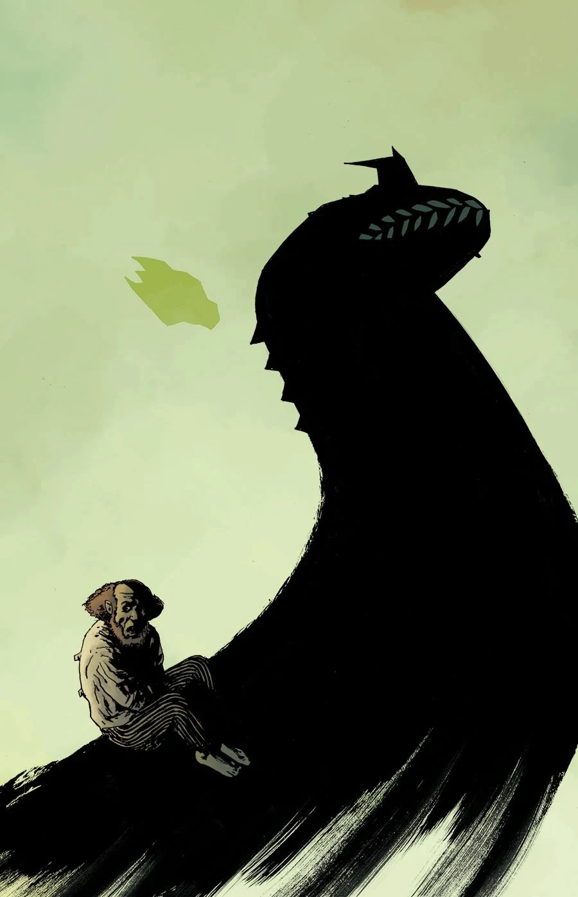
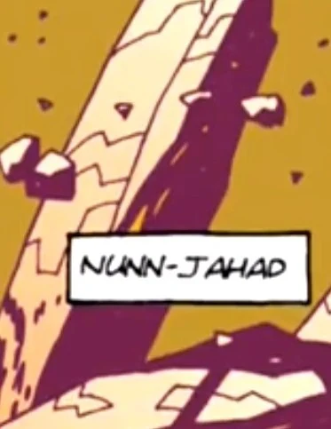
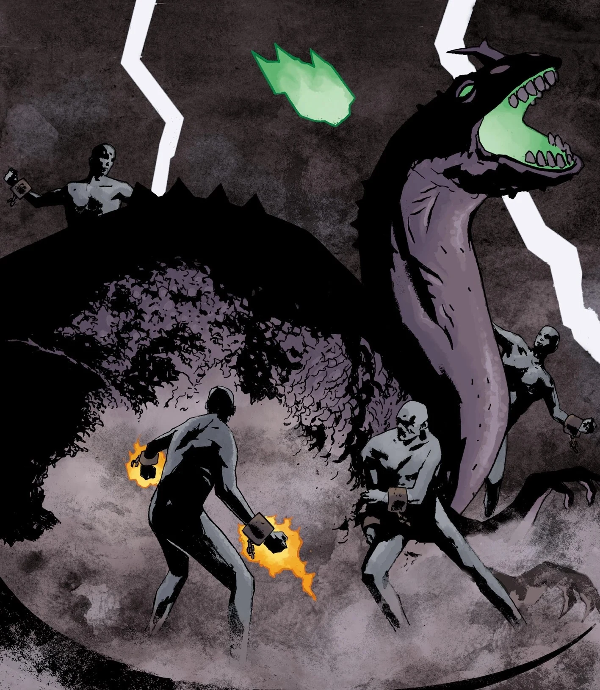
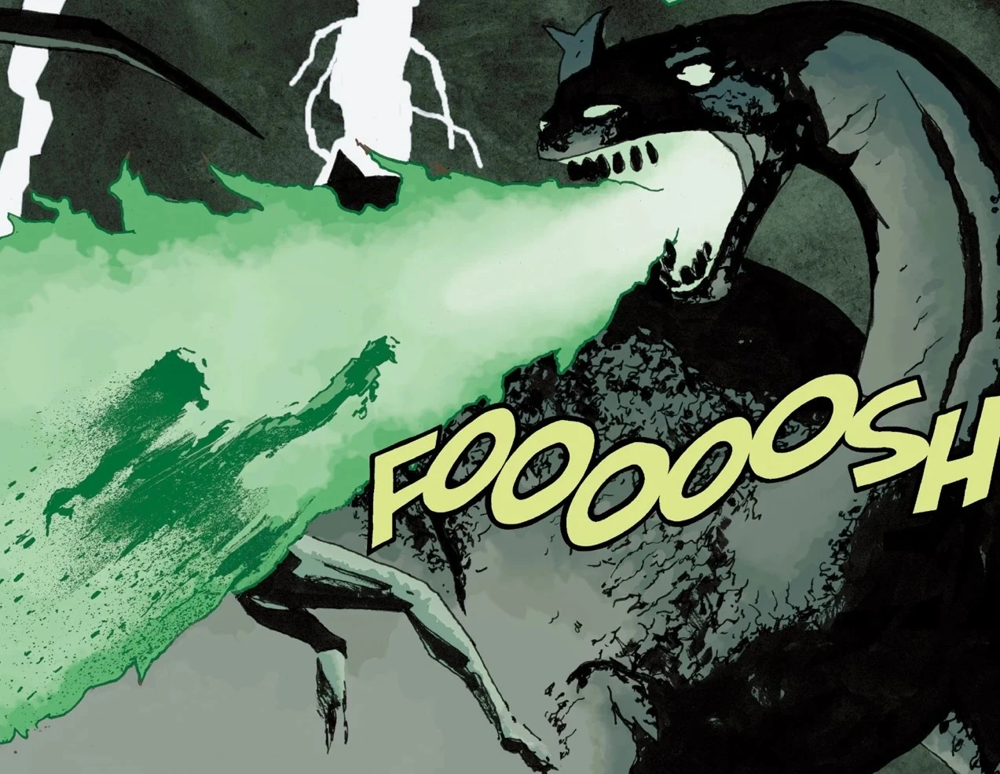
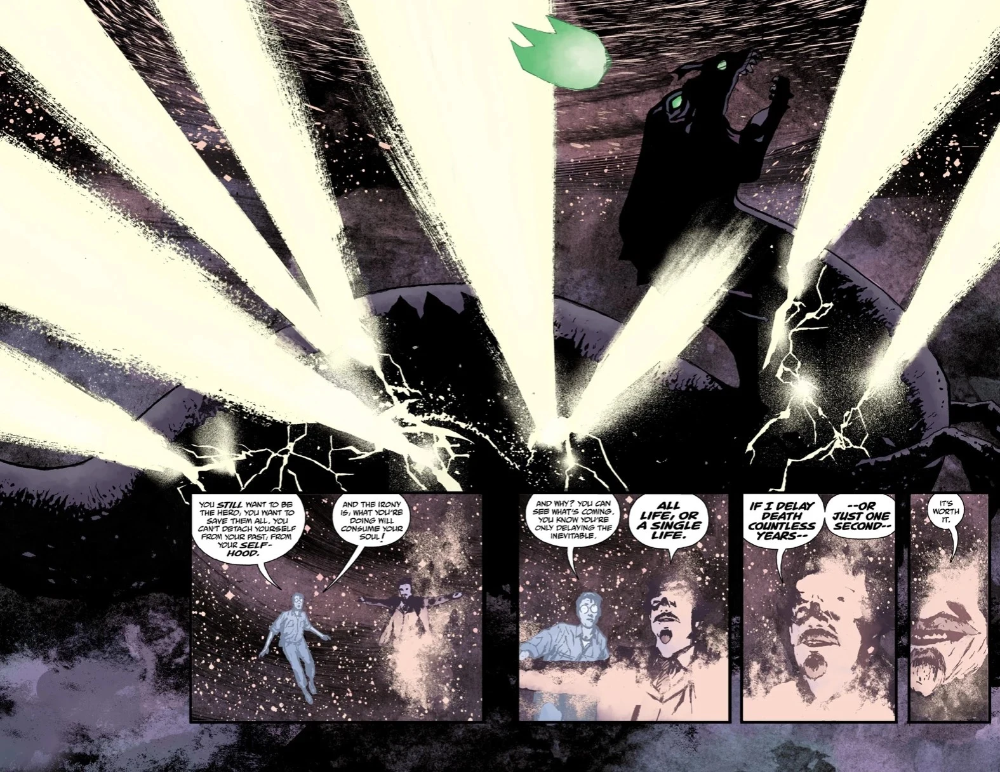

纳恩**-贾哈德**(Nunn-Jahad)是[奥古·桀哈](/entry/Ogdru_Jahad)——混沌七神之一。它在 *《B.P.R.D.》* 系列的"人间地狱"故事篇章中担任最终反派。

## 传记

### 起源

太初之时，大灵[阿努姆](/entry/Anum)(Anum)借用了[上帝](/entry/God)的一部分力量，创造了纳恩-贾哈德与它的六个同胞。混沌七神苏醒之后，产下了恶魔般的[奥格德鲁·赫姆](/entry/Ogdru_Hem)，后者随即与众灵开战。众灵击败了赫姆，并将混沌七神封入金色的水晶茧中，投入[深渊](/entry/Abyss)。释放它们的唯一途径，便是阿努姆的[毁灭之右手](/entry/Right_Hand_of_Doom)。

它与其余六位同胞一样，会从远方影响世间之人，例如[格里高利·拉斯普廷](/entry/Grigori_Rasputin)。

### 降临地球

纳恩-贾哈德先于其余六位同胞逃出水晶囚笼，坠毁于堪萨斯州阿真特(Argent)，将方圆数英里的地区夷为废墟。随着特殊科学局(SSS)与[超自然调查防御署](/entry/B.P.R.D.)双双动员，纳恩-贾哈德立即产下了一批奥格德鲁·赫姆。丽兹与[约翰](/entry/Johann_Kraus)消灭了这些奥格德鲁·赫姆，却无法伤及巨龙本身，被迫撤退。它的降临还将自身接入了为[黑焰](/entry/The_Black_Flame)供能的精神网络。

黑焰被击败后，纳恩-贾哈德开始移动，所到之处伴随着火与闪电的风暴。它每小时都吐出数十只奥格德鲁·赫姆，令丽兹与约翰遏制浪潮的努力归于徒劳。军队向它发射了所有可用的核弹头，它却毫发无损地幸存下来。它最终经过超自然调查防御署总部，用一颗火球将其摧毁，[凯特](/entry/Katherine_Corrigan)与[潘雅](/entry/Panya_(character))不幸罹难。此后，数名由瓦尔瓦拉召来的地狱守望者前来截击它。尽管它们奋力作战，纳恩-贾哈德还是将它们焚为灰烬。最终，约翰引导维利(Vril)的无限之力将巨龙击碎，它就此被消灭，约翰也在这一过程中牺牲。随着它的死亡，全球各地的奥格德鲁·赫姆都停止了移动、不再显示任何生命迹象，为世界赢得了短暂的喘息。

复活后的格里高利·拉斯普廷后来自称"地球上的奥古·桀哈"。粉丝们推测纳恩-贾哈德的力量进入了他的体内，这也能解释奥格德鲁·赫姆的复活。《拉格纳·洛克》(Ragna Rok，故事篇章)。

## 外形

纳恩-贾哈德的外形类似一种过时的角鼻龙(*ceratosaurus*)复原形象，其吻部上长有一只角，尤为显眼。

纳恩-贾哈德的身躯也很浑圆，可能给人一种行动笨拙的错觉，但这丝毫没有削弱这条巨龙的毁灭能力。

## 画廊

向阿努姆与守望者复仇——它们囚禁了它和它的六个同胞

纳恩-贾哈德被约翰·克劳斯摧毁。

|

|

|Revenge on Anum & the watchers for imprisoned him and his six siblings

|

|Nunn-Jahad destroyed by Johann Kraus.
## 登场

- [《末日》](/entry/End_of_Days)
- [《时辰已至》](/entry/Cometh_the_Hour)
- [《弥赛亚》](/entry/Messiah)（闪回）
- [《混沌》](/entry/Pandemonium_(story_arc))（监控画面中的影像）

## 趣闻

- 纳恩-贾哈德的外形类似角鼻龙，也像韩国电影怪兽龙加利(Yongary)。
