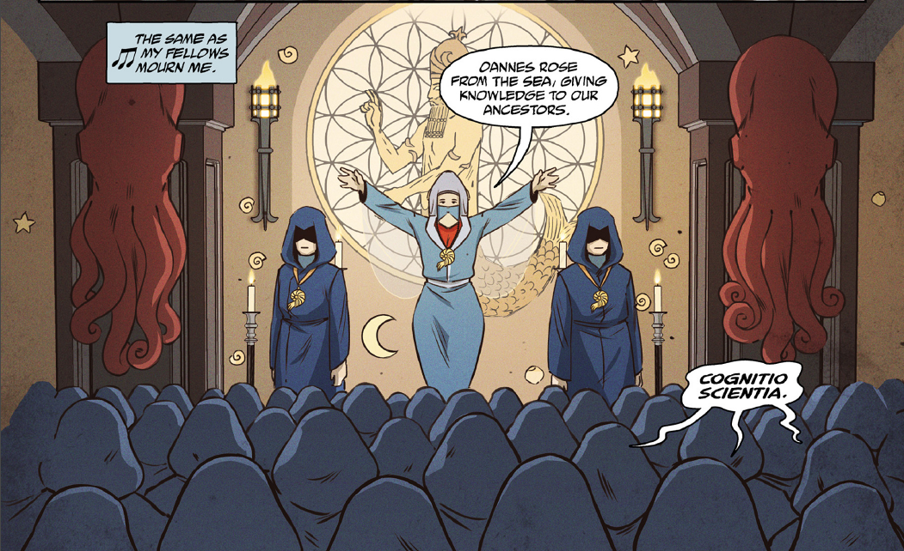

 **奥安尼斯学会（Oannes Society）**是从[拉神赫利奥皮斯兄弟会](/entry/Heliopic_Brotherhood_of_Ra)中分裂出来的一个团体，由该组织的前成员组成，他们相信神祇[阿图姆](/entry/Atum)起源于海洋。

## 历史

18 世纪，[拉神赫利奥皮斯兄弟会](/entry/Heliopic_Brotherhood_of_Ra)内部两派围绕阿图姆的起源展开了一场激烈而充满争议的辩论，另一方坚信托阿图姆"诞生于大海"。这场辩论导致支持海洋起源说的成员退出兄弟会，另组奥安尼斯学会。学会虽与兄弟会目标相通，却坚持认为生命与一切知识都源自海洋。不过，与兄弟会相比，学会的成员寥寥无几。

19 世纪，奥安尼斯学会接纳[兰登·埃弗里特·考尔](/entry/Langdon_Everett_Caul)入会。这一时期，学会围绕一只盛有一位[神祇](/entry/Water_Spirit)的茧举行了一场秘术仪式，导致考尔蜕变成了一个"鱼形智人"（Ichthyo sapien）。考尔刚完成蜕变，学会便认定他是奥安尼斯的化身，把他养在一个保存槽中。学会似乎还与 Abraham Lincoln 总统遇刺一案有所牵连，被迫离开美国，将考尔遗弃在他们位于华盛顿特区的隐秘美国总部。一个世纪后，考尔在那里被 [B.P.R.D.](/entry/Bureau_for_Paranormal_Research_and_Defense) 发现，并取名为[亚伯拉罕·塞皮恩](/entry/Abraham_Sapien)。

离开美国后不久，古老的木乃伊[潘雅](/entry/Panya_%28character%29)联系了学会，请求他们帮她逃离拉神赫利奥皮斯兄弟会。然而学会非但没有放她自由，反而将她绑架，以埃及海洋女神之名为她改名 Naunet。他们把她偷运到印度尼西亚的一座岛屿上，在那里秘密生活、活动了 140 多年。岁月流转，同一批成员靠着"黑暗科学"的手段，把自己衰老脆弱的身躯转移进简陋的义体之中，以此苟活。

到了 21 世纪初，学会认定世界末日将至，企图通过屠杀数以百万计的人来"拯救"人类，使至少大部分人类与神性重聚：他们在战略要地布置能够制造地震的机器，用以掀起毁灭性的人工海啸，肆虐南半球；南半球人口的灵魂随后可被学会收割，注入为此专门培育的培养槽躯体之中，让他们获得神一般的力量。然而，潘雅联系了亚伯·塞皮恩，带他与学会重逢；亚伯拒绝让他们的计划得逞，只身摧毁了整个学会。

不过，学会成员之一 McWhirter 活了下来：他在几乎被炸碎后落入附近海中，学会维多利亚时代的潜艇正停泊在那里。他乘潜艇逃走，最后一次出现时，正在收看一则电视新闻，报道有人在加利福尼亚州索尔顿湖目击到一只[奥格德鲁·赫姆](/entry/Ogdru_Hem)。

## 成员

- [霍奇森勋爵](/entry/Lord_Hodgson)
- [兰登·埃弗里特·考尔](/entry/Langdon_Everett_Caul)
- Edward Musgrove Sundborne（肉身形态）（已故）
- Phillip Ensner（金色机械躯体）（已故）
- Dameron（灰色机械躯体）（已故）
- McWhirter（青铜色机械躯体）
