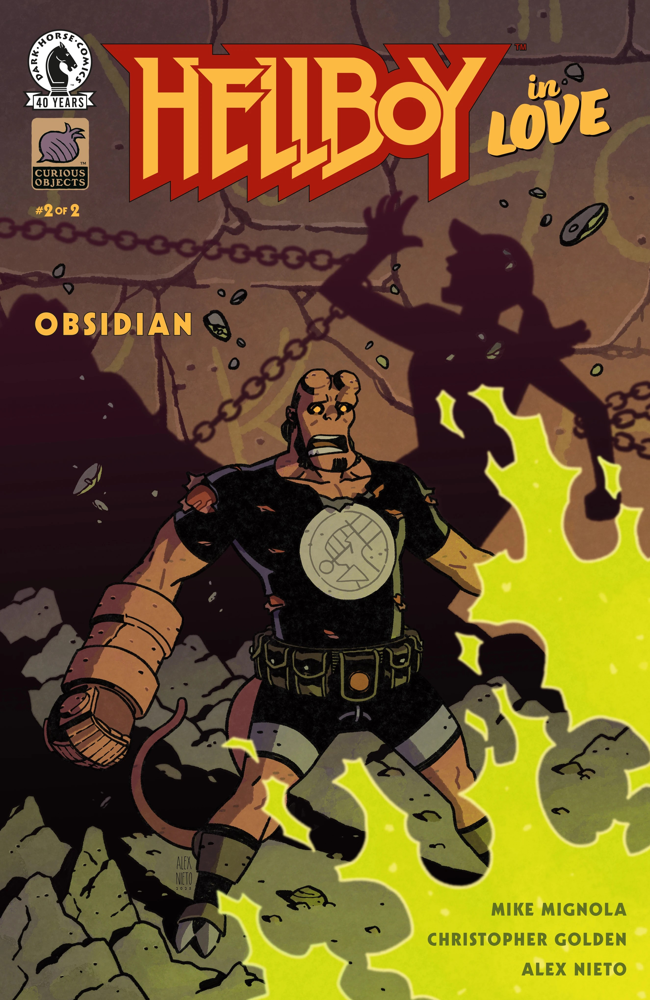

***《黑曜石》（Obsidian）***是 *[《恋爱中的地狱男爵》](/entry/Hellboy_in_Love)* 中由 [Mike Mignola](/entry/Mike_Mignola) 与 [Christopher Golden](/entry/Christopher_Golden) 编剧的一个双期故事线。它是该系列的第六个故事线。

## 剧情简介

### 第一部分

一支挖掘队在克里特岛发掘出一座古墓，其特征与阿纳斯塔西娅在印度被一个女巫偷走的那颗刻纹头骨惊人地相似，于是她被召往克里特岛。关于神秘的苏阿伦·阿蒂亚（Suaren Artea）社团的证据线索，或许并不像她原以为的那样已经断了，但危险仍潜伏在每一个转折之后。

### 第二部分

阿纳斯塔西娅与地狱男爵正在追查一个邪教组织，以获取阻止一场末日灾难所需的答案，但邪教可能会先一步追上他们。而他们的麻烦才刚刚开始——随着一个远超常理的庞然巨物从古老洞穴中现身，希腊的发掘现场骤然变得更加恐怖。

## 画廊

全部封面均由 Alex Nieto 绘制。

*《恋爱中的地狱男爵：黑曜石》* \#1

*《恋爱中的地狱男爵：黑曜石》* \#2

|Hellboy in Love: Obsidian #2
