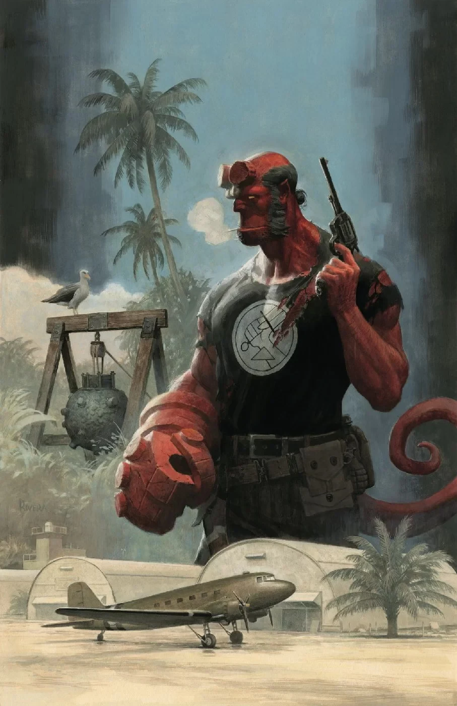
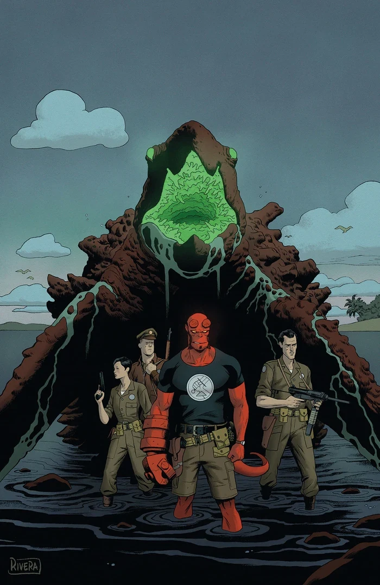
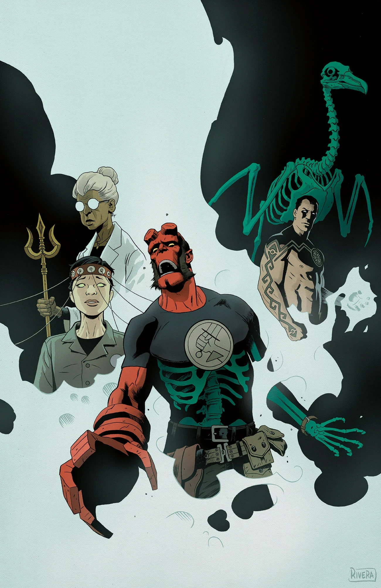

《**Occult Intelligence**》（秘术情报）是 *[Hellboy and the B.P.R.D.](/entry/Hellboy_and_the_B.P.R.D.): 1955* 的一个三期故事弧，由 Mike Mignola 与 Chris Roberson 编剧，Brian Churilla 作画。

## 剧情简介

### 第一部

一次在偏远岛屿的中转停留，让地狱男爵卷入了一张阴谋之网：政府机密与外国特工围绕一件或许正合 B.P.R.D. 本行的武器，进行着他们自己的冷战。在英格兰，布鲁姆挖出了更多秘密，种种迹象表明一场遍及全球的超自然冲突即将爆发。

### 第二部

热带地区的谜案随着一头怪物的袭击而骤然升温，但这头生物或许与一场国际冲突核心处的秘密武器有所牵连。另一边，布鲁姆自己的调查显示，B.P.R.D. 卷入的事件远比他想象的庞大。

### 第三部

B.P.R.D. 探员们惊讶地发现，一个老对头牵涉进了岛上的袭击事件；布鲁姆则深入挖掘，要揭开一场国际超自然冲突的真相以及 B.P.R.D. 在其中扮演的角色。

## 画廊

|*Occult Intelligence* \#1

|*Occult Intelligence* \#2

|*Occult Intelligence* \#3
