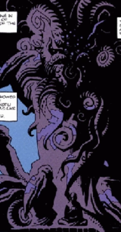
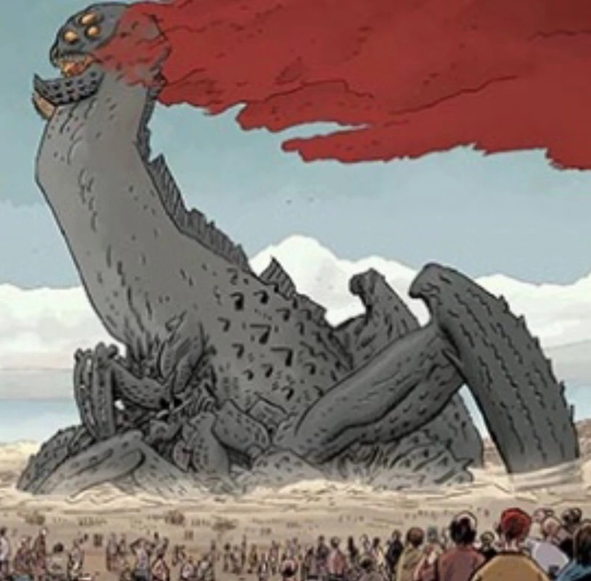
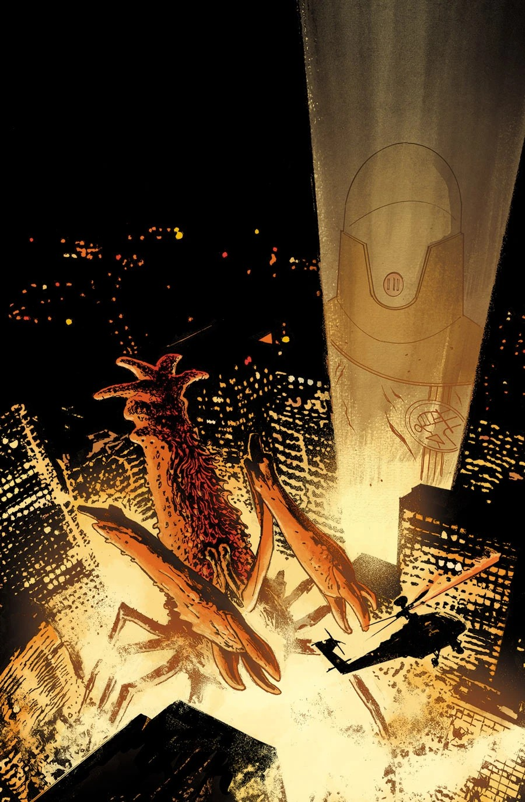
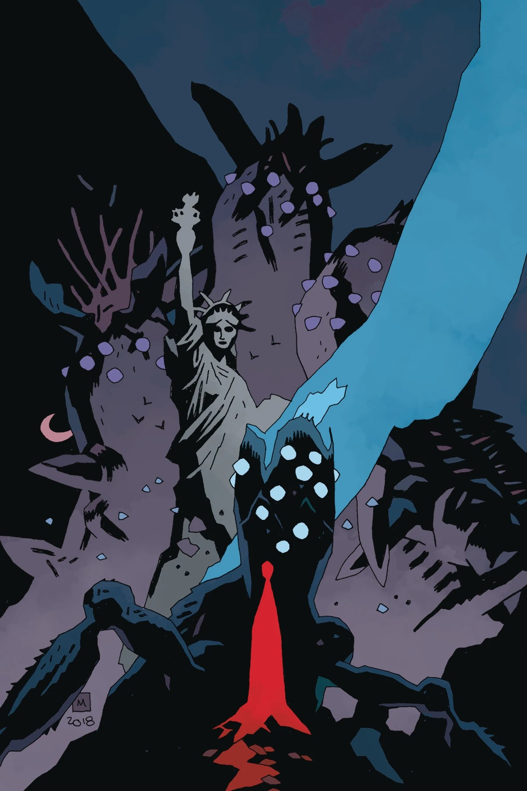
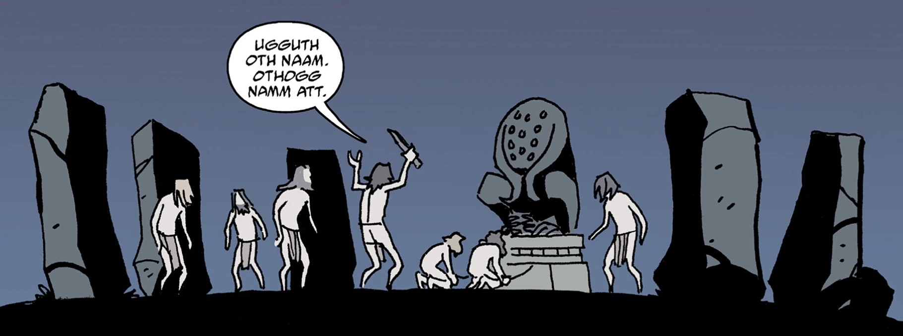
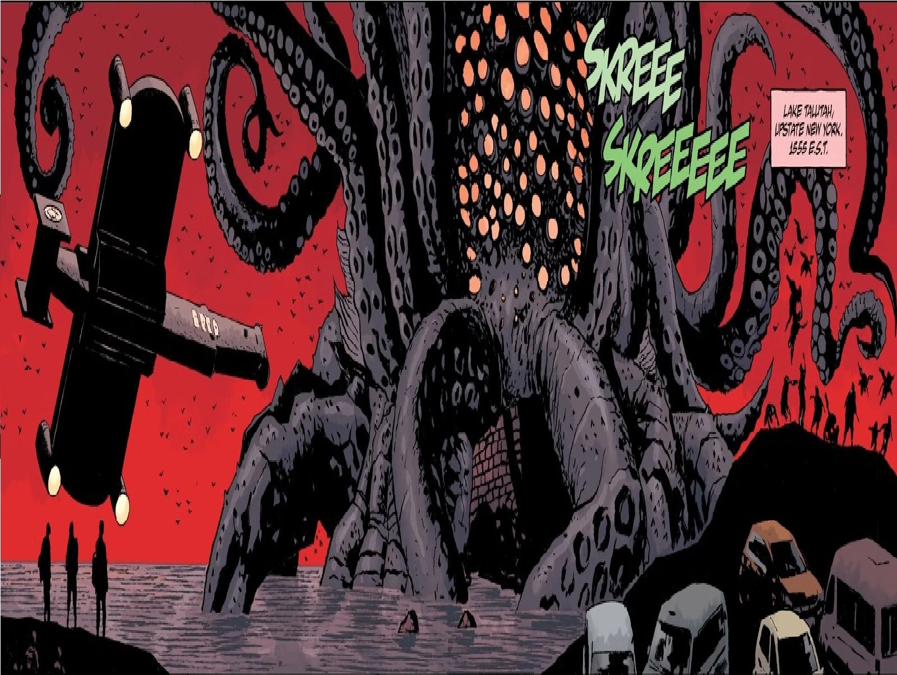

三百六十九只奥格德鲁·赫姆；守望者们一看到奥格德鲁·赫姆便充满恐惧，于是向它们开战。

～那人向地狱男爵口述真实的历史，告诉他奥格德鲁·赫姆虽被击败，却仍然活着。终有一天它们会苏醒，重新夺回大地。

**奥格德鲁·赫姆（Ogdru Hem）**是[奥古·桀哈](/entry/Ogdru_Jahad)所生的三百六十九个怪物子嗣，是《地狱男爵》系列中的反派，尤其在《B.P.R.D.》系列的“人间地狱”篇章中担任主要反派。

奥格德鲁·赫姆本质上是其父母的弱化版本，可即便如此，它们仍拥有难以想象的力量。所有奥格德鲁·赫姆都曾被守望者们囚禁，但在[格里高利·拉斯普廷](/entry/Grigori_Rasputin)及其他奥古·桀哈爪牙的协助下，如今许多奥格德鲁·赫姆正重新现身。

许多奥格德鲁·赫姆没有躯体，也无形无相，无形地存在于空气中与外太空／宇宙之中。这些恶灵被用来帮助那些有身体的奥格德鲁·赫姆（例如[卡塔-赫姆（Katha-Hem）](/entry/Katha-Hem)）挣脱它们在尘世的牢狱，或是试图附身活体以重返物质形态。

经研究发现，至少一只奥格德鲁·赫姆——[萨杜-赫姆（Sadu-Hem）](/entry/Sadu-Hem)——的物质形态是一种真菌。这具身体是在远古某个时期由血液所造，因此奥古·桀哈最初创造的那些躯体是否同样如此，尚不清楚。

所有奥格德鲁·赫姆都能用呼吸使活物变异，最常见的例子便是[蛙怪](/entry/Frog_monster)——它们曾试图借此催生人类第三种族，但它们的造物不过是[亚伯·塞皮恩](/entry/Abe_Sapien)——第三种族真正的代表——的拙劣仿制品。其他奥格德鲁·赫姆则造出了各种各样的生物：卡塔-赫姆繁衍出头颅燃烧的存在，[索尔顿湖怪物](/entry/Salton_Sea_Monster)把人类变异成昆虫般的生物，还有一些则把人类变成僵尸。

## 历史

###### 背景

三百六十九只奥格德鲁·赫姆在奥古·桀哈终于苏醒的那一夜由它所生，因此是地球上最早的生命形态。当守望者们——奥古·桀哈的创造者——看到这些生物时，他们惊恐万状，向它们开战。一万年之后，守望者们意识到他们无法真正杀死奥格德鲁·赫姆：即使摧毁了这些生物的躯体，它们的灵魂仍徘徊不去。于是，守望者们把剩余三分之一的奥格德鲁·赫姆囚禁在大地之下，而奥古·桀哈则被封入金色的水晶茧中，抛入深渊。

尽管奥格德鲁·赫姆被击败，它们的灵魂仍凶猛地试图重返物质世界，附身于生物的躯体并把它们变作自己的模样。人类第一种族——[海伯利亚人](/entry/Hyperboreans)——运用强大的魔法压制着这些奥格德鲁之灵。然而，在他们文明的暮年，对黑暗女神赫卡特的崇拜带来了邪恶的魔法，将奥格德鲁之灵重新召唤回世间。[海伯利亚](/entry/Hyperboreans)萨满担心这些奥格德鲁之灵会在人类——第二种族——得以主宰世界之前将其毁灭，于是训练了一批人类修习维利之道，以抵挡这些灵魂。一些奥格德鲁·赫姆成功使人类倒向它们的事业，把他们变成一种被称为寒族的原始[吸血鬼](/entry/Vampire_(creature))，但人类萨满及其他受海伯利亚力量祝福的勇士们的努力，阻止了它们站稳脚跟。这些英雄及其与奥格德鲁·赫姆战斗的传说流传到了玛雅、阿兹特克等古代文明中，后者在神话中铭记着[西帕克特赫姆](/entry/Cipactlhem)和[乌库布·卡奎克斯](/entry/Vucub_Caquix)之类的存在。另一些则可能被记为龙。

## 阿兹特克人

据詹姆斯·亨利·奥唐奈尔所说，整个“中美洲神怪”万神殿——例如[魁札尔科亚特尔](/entry/Quetzalcoatl)——实际上都是部分奥格德鲁·赫姆的灵魂。

托尔特克人的血祭使这些生物得以获得物质形态，并向人们讲述世界的真实历史；阿兹特克人后来把这段历史刻在三块金板上。

## 现代

“访客”处理了大多数显现事件，但有少数几次逃过了他。尽管地狱男爵当时并不知情，在[卡文迪什庄园](/entry/Cavendish_Hall)事件之前他就曾遭遇两只奥格德鲁之灵：一只是 1965 年在法国的拉诺修道院（Abbey of La Noe），另一只在 1979 年，它劫持了著名灵媒[托德先生](/entry/Goodbye_Mister_Tod)的灵质。

拉斯普廷唤醒了萨杜-赫姆，但它被[丽兹·舍曼](/entry/Elizabeth_Sherman)摧毁。后来[赫尔曼·冯·卡朗普特](/entry/Herman_von_Klempt)召唤了[征服者蠕虫](/entry/Conqueror_Worm_(Ogdru_Hem))，被[罗杰](/entry/Roger)、地狱男爵和[大螯虾强生](/entry/Lobster_Johnson)摧毁。地狱男爵后来又战斗并杀死了复活的[乌尔戈-赫姆（Urgo-Hem）](/entry/Urgo-Hem)。萨杜-赫姆开始再生后，它被超自然调查防御署的研究人员捕获并任其生长，随后被邪教徒释放，得以制造出大量蛙怪。这些蛙怪后来又召唤了大批奥格德鲁·赫姆之灵，但其中有多少重获物质形态很值得怀疑。

[兰迪斯·波普](/entry/Landis_Pope)后来应验了[黑焰](/entry/The_Black_Flame)的蛙之预言，唤醒了卡塔-赫姆；它的现身标志着世界即将开始改变。尽管丽兹·舍曼击败了卡塔-赫姆，兰迪斯·波普却活了下来，并在恐惧之王及其机器的帮助下转而复活奥格德鲁·赫姆，而非将它们唤醒。虽然这些复活者都被丽兹·舍曼摧毁，索尔顿湖怪物不久后便爬出了海洋，标志着人间地狱的开端。

### 人间地狱

丽兹焚毁空心地球、引发地震震动世界之后，她的爆炸惊动了许多沉睡的奥格德鲁之灵，它们随即开始向世间伸展，试图重获物质形态。索尔顿湖怪物开始移动，所过之处产卵。当[利奥波德·克茨](/entry/Leopold_Kurtz)和[卡尔·鲁普雷希特·克焰人](/entry/Karl_Ruprect_Kroenen)在[津科总部](/entry/Zinco_Corporation)召唤出新的黑焰时，它立刻唤醒了囚禁在全球各地的许多奥格德鲁·赫姆，令当前的危机急剧恶化。后来农-桀哈降临地球，开始从自己体内不断繁衍出大量奥格德鲁·赫姆，它们行军途中将美国中部夷为废墟。农-桀哈最终被杀后，奥格德鲁·赫姆随之僵住、停止活动，世界得以喘息片刻。

### 拉格纳·洛克

随着[约姆雅尔](/entry/Yomyael)之死，以及[瓦尔瓦拉](/entry/Varvara)摆脱恶魔的控制，她设法复活了父亲拉斯普廷。此时的拉斯普廷获得了农-桀哈黑暗精华的力量，立刻复活了地球上所有的奥格德鲁·赫姆。不仅是无形的灵魂，就连此前已被击败的奥格德鲁·赫姆（例如萨杜-赫姆）也不例外。所有存在终于都重归物质形态，而且比以往任何时候都更加强大；它们立即蹂躏星球上残存的一切，迫使人类残余势力到地下的空心地球中避难。地狱男爵和他的朋友们虽设法击败了拉斯普廷，却为时已晚——奥格德鲁·赫姆此时已是地球上无可争议的主宰。它们和它们繁衍出的无数怪物一直是地球的优势物种，直到许多个体在奥古·桀哈的牢笼撞击地球所引发的爆炸中被毁灭，其精华被[奥西里斯俱乐部](/entry/Osiris_Club)窃走。地狱男爵之魂摧毁了它们，并（在[赫卡特](/entry/Hecate)的帮助下）让伊丽莎白·舍曼释放全部力量，抹去了地球表面的一切生命（代价是她自己的生命）。残存的奥格德鲁·赫姆似乎都在这场烈焰中灭亡。经此一役，奥格德鲁·赫姆看似已经灭绝；但是否还有它们的灵魂以某种形式存续，仍不得而知。

## 奥格德鲁·赫姆名录

- [西帕克特赫姆](/entry/Cipactlhem)
- [征服者蠕虫](/entry/Conqueror_Worm_(Ogdru_Hem))
- [根努-赫姆（Ghennu-Hem）](/entry/Ghennu-Hem)
- [伊斯特拉-赫姆（Istra-Hem）](/entry/Istra-Hem)
- [卡塔-赫姆](/entry/Katha-Hem)
- [梅拉-赫姆（Mera-Hem）](/entry/Mera-Hem)
- [托德先生的怪物](/entry/Goodbye_Mister_Tod)
- [萨杜-赫姆](/entry/Sadu-Hem)
- [乌尔戈-赫姆](/entry/Urgo-Hem)
- [约塔-赫姆（Yotha-Hem）](/entry/Yotha-Hem)
- [扎拉-赫姆（Zara-Hem）](/entry/Zara-Hem)
- [索尔顿湖怪物](/entry/Salton_Sea_Monster)
- [魁札尔科亚特尔](/entry/Quetzalcoatl)
- [乌库布·卡奎克斯](/entry/Vucub_Caquix)

## 画廊

西帕克特赫姆

根努-赫姆

伊斯特拉-赫姆

乌库布·卡奎克斯

扎拉-赫姆

|Sadu-Hem

|Salton Sea Monster

|

|

|

|
## 相似生物

曾有若干生物与奥古·桀哈有所关联，但并未被说明是奥格德鲁·赫姆。

- **[萨麦尔](/entry/Sammael)，荒芜者**：《地狱男爵》电影中的这只地狱猎犬被推测是三百六十九只之一。尽管萨麦尔在外形上与[蛙怪](/entry/Frog_monster)的共同点比与一只完全体奥格德鲁·赫姆更多，亚伯·塞皮恩却称他为“涅伽尔之子”，而涅伽尔是七位奥古·桀哈之一。萨麦尔众多头衔中的一个——“[毁灭之种](/entry/Seed_of_Destruction)”——是对同名漫画故事线的致敬，奥古·桀哈正是在那条故事线中首次登场。

<!-- -->

- **[贝希摩斯](/entry/Behemoth)**：《地狱男爵》中那只形似水螅的贝希摩斯也可能是一只奥格德鲁·赫姆，充当拉斯普廷的神。拉斯普廷一死，贝希摩斯便从他的体内喷发而出，如同*[《地狱男爵：岛屿》](/entry/The_Island)*中乌尔戈-赫姆借着祭司之血被释放一样，并长到了巨大的体型。贝希摩斯在体型、外貌和脾性上都与[萨杜-赫姆](/entry/Sadu-Hem)十分相似。[地狱男爵](/entry/Hellboy_(character))把一排手雷塞进它的喉咙，将其杀死。

<!-- -->

- **“雷”与“电”**：封印在风暴之剑中的两只邪恶日本风暴恶魔，登场于《地狱男爵：风暴之剑》。它们不能算作奥格德鲁·赫姆，而更应说是奥古·桀哈的兄弟——后者被称作“诸龙”。

## 注释

1.  [↑](#cite_ref-1) 在*[《征服者蠕虫》](/entry/Conqueror_Worm_(story))*第 2 期中，该生物被说明与征服者蠕虫属于同一物种。
