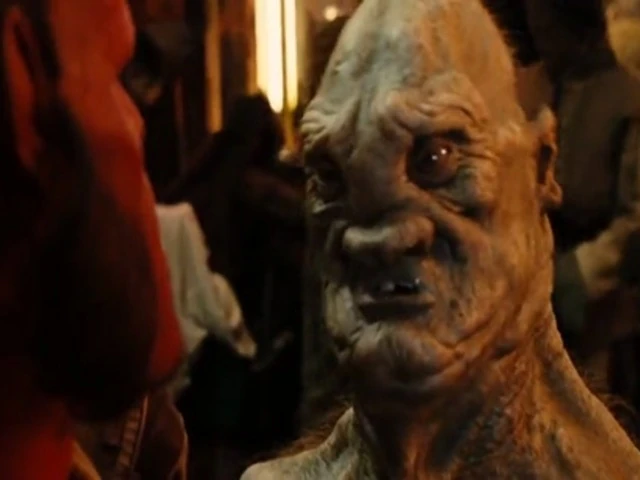

食人魔是传说中的一个种族，长着灰色的疣状皮肤和尖脑袋，身上还会长出能够获得自我意识的肿瘤。

## 在地狱男爵中的登场

在《地狱男爵 2：黄金军团》中，食人魔被揭示曾与同族的精灵、哥布林、巨魔和仙子一起参加对抗人类的战争，但许多食人魔在这场浩劫中丧生。

一只食人魔出现在巨魔市场里，一名[克朗尼巨魔（Cronie Troll）](/entry/Cronie_Troll)理发师正在为他刮脸，他身上长着一个会说话的肿瘤。当他拒绝透露是谁买走了一些非法牙仙时，被“红”扇了许多个耳光，随后他供出买主是努阿达王子。当约翰·克劳斯把他的肿瘤叫作婴儿时，他明显十分恼火。
