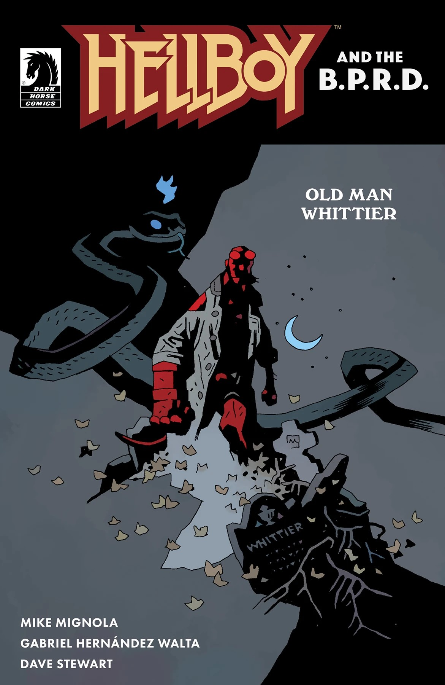

***《惠蒂尔老头》***（Old Man Whittier）是 *[地狱男爵与超自然调查防御署](/entry/Hellboy_and_the_B.P.R.D.)* 的一个单篇故事弧，编剧为 Mike Mignola，作画为 Gabriel Hernández Walta。

## 剧情简介

惠蒂尔一家麻烦缠身！当凯瑟琳·惠蒂尔（Catherine Whittier）得知自己继承了家族老宅时，她很清楚不该独自回去；而地狱男爵与这家人打交道的经历（见《地狱男爵：惠蒂尔的遗产》）使他成为最合适的人选，去确保任何不善的魂灵都得到安息。因为在一座有这般历史的宅子里，“plot”的含义可不只是一块家族墓地。

## 画廊

*地狱男爵与超自然调查防御署：  
《惠蒂尔老头》*  
Gabriel Hernández Walta 作

*地狱男爵与超自然调查防御署：  
《惠蒂尔老头》*  
Mike Mignola 与 Dave Stewart 作

|Hellboy and the B.P.R.D.: Old Man Whittier by Mike Mignola and Dave Stewart
