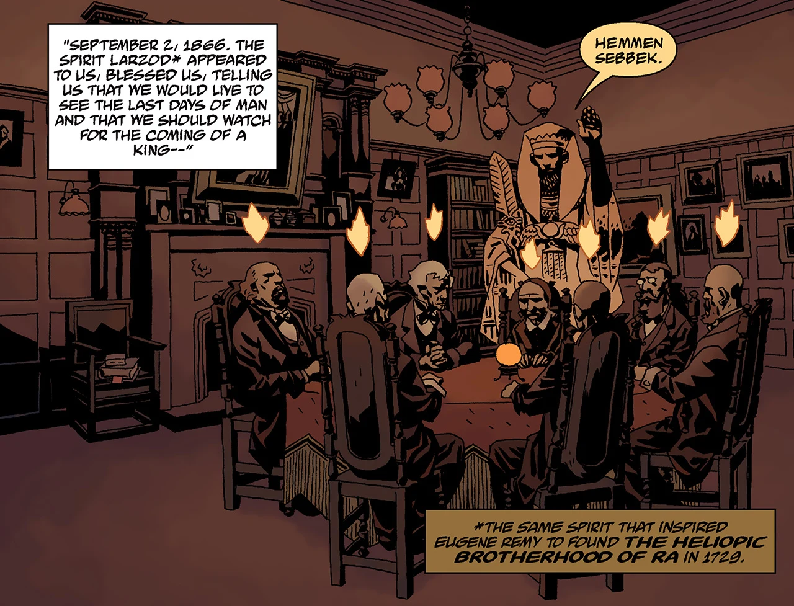

 **奥西里斯俱乐部（Osiris Club）**是一个成立于 1866 年的秘密社团，从[拉神赫利奥皮斯兄弟会](/entry/Heliopic_Brotherhood_of_Ra)中独立分支出来。

## 历史

1866 年 9 月 2 日，[拉神赫利奥皮斯兄弟会](/entry/Heliopic_Brotherhood_of_Ra)的六名成员——其中包括三名高层——在 Charles Burly 勋爵府上拜访了神秘学家 [E.T. 哈顿小姐](/entry/Miss_E.T._Hatton)，并举行了一场降神会。降神会中，[Larzod](/entry/Larzod)的灵魂造访了他们——正是这个灵魂曾启发 Eugene Remy 创立赫利奥皮斯兄弟会。它赐予他们永生，让他们见证"人类的末日"，以及一位君王的降临：这位君王将"拒绝自己的王冠"，但"最终会率领［他的士兵］投身最后一战"并被杀；届时，被选中的七人将砍下他的右手，用它"凌驾于一切残存之物之上"。这七人便成了奥西里斯俱乐部的创始成员。

一个多世纪后的 1954 年，俱乐部认为[地狱男爵](/entry/Hellboy)可能就是预言中的那位君王，便派他去斩杀一条曾被圣伦纳德斩杀的龙，以此考验他的德行。然而考验的结果始终不明：地狱男爵虽杀死了圣伦纳德蠕虫，但他伤口流出的血滴落在地，竟从血中长出了百合花，与圣伦纳德的古老传说遥相呼应。

2007 年，在《[狂猎](/entry/The_Wild_Hunt)》的事件中，奥西里斯俱乐部把地狱男爵召到英格兰参加狂猎，结果猎人们却向地狱男爵发难，企图在他以莫德雷德后裔的身份认领与生俱来的权利之前杀死他。后来，当他们得知地狱男爵取得王者之剑、暴露出他们的私人图谋后，最初的七名元老清洗了较新的成员——其中两人曾试图把事态变化通报首相。在《[狂怒](/entry/The_Fury)》事件之后，奥西里斯俱乐部讨论着地狱男爵之死带来的变局：他们当时没能取得他的右手，而世界的末日才刚刚开始。

拉格纳洛克一役中地狱男爵与[拉斯普京](/entry/Rasputin)同归于尽后，奥西里斯俱乐部把毁灭之右手据为己有。他们利用这只手从深空召来[奥古·桀哈](/entry/Ogdru_Jahad)的水晶牢笼，让它像小行星一样坠向地球。撞击的冲击抹去了曾统治地球的[奥格德鲁·赫姆](/entry/Ogdru_Hem)。随后他们窃取了巨龙的生命与力量，封存在右手之中，打算借此飞升成神。然而地狱男爵的鬼魂夺回了自己的手，并杀死了他们。
