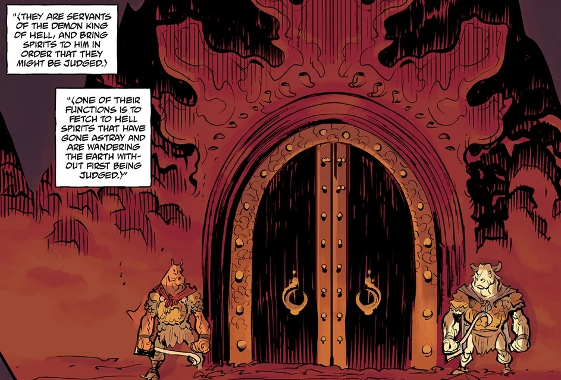

**牛头马面（Ox-Head and Horse-Face）**是两名负责将灵魂押送到冥界的亚洲恶魔。

## 背景

 牛头马面是地狱魔王的仆从，负责把鬼魂带到魔王面前接受审判。他们的职责是捉拿走失、游荡在人间的地狱亡魂。

## 历史

1953 年，牛头马面感知到凡界出现灵魂扰动，于是在人间显形。他们出现在香港郊外的一片棚户区。他们发现，不仅鬼月节来访的亡魂，连活着的居民都被抓走囚禁。两名恶魔决心纠正这种失衡，循扰动追踪到一个名叫 [Thomas Rhymes](/entry/Thomas_Rhymes) 的人类术士——此人利用神器[魂瓶](/entry/Hunping)囚禁灵魂，用它们为自己增强力量。

他们无法拿办术士，因为此人在自己的力量之地布下强大的结界，使他们无法靠近。两名恶魔与[地狱男爵](/entry/Hellboy)及[超自然调查防御署（B.P.R.D.）](/entry/Bureau_for_Paranormal_Research_and_Defense)的特工发生冲突，他们要求归还灵魂。双方随即打了起来，但当两名恶魔意识到灵魂的事更为紧要时，打斗很快停止。

当地狱男爵成功将神器砸成碎片时，牛头马面把灵魂送回了各自应在之处——既有冥界也有阳世。他们为此感谢表亲地狱男爵，承诺魔王会记住这份恩情，随后飞入夜空离去。[1]

## 性格

与许多心怀险恶企图和目标的欧洲恶魔不同，牛头马面实际上是人类灵魂的守护者。他们将自己的职责视为头等大事，只有在无法履行职责时才会动怒并诉诸暴力。正常情况下他们似乎是性情温和的生物：他们认出地狱男爵是自己的同族，既不因他与人类共事而怀恨，甚至在被他揍了一顿之后也不记仇。

## 能力

这两名恶魔是强大的存在，与地狱男爵交手时不落下风，在他的痛击下也几乎毫发无伤。他们具备灵气探测能力，能隔着数个维度感知到被囚禁的灵魂，并能操控灵魂，将其送回原本的容器。他们拥有一定程度的变形能力，可以长出一对翅膀飞行。

## 参考资料

[1] [《幽灵之月》](/entry/Ghost_Moon)
