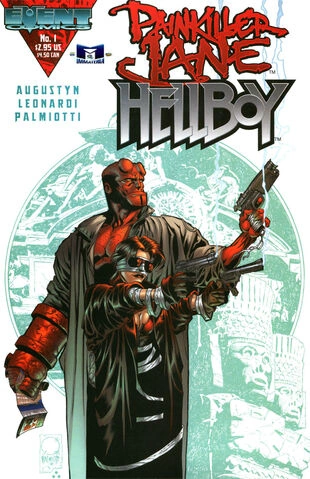

*《古老的笑声》（Ancient Laughter）*是由 Event Comics 出版的一部脱离正典的单期跨界漫画。

## 剧情简介

故事围绕在一处建筑工地地基中发掘出的一只古老美洲原住民骨灰瓮展开。不顾部落长老格雷戈里·双熊（Gregory Two Bears）的反对，该市自然历史博物馆的研究人员无意中破坏了骨灰瓮的封印，释放出一个名为马尼斯基特（Maniskeet）的邪恶生物。这个超自然实体威胁要把整座城市变成一片原始森林。这场危机让两个看似不可能的盟友走到了一起：来自黑马漫画的超自然调查员地狱男爵，以及由 Jimmy Palmiotti 和 Joe Quesada 为 Event Comics 创作的拥有再生能力的义警《止痛剂简》（Painkiller Jane）。

## 画廊

*封面作者：[迈克·米格诺拉](/entry/Mike_Mignola)*

*变体封面作者：Joe Quesada*

|variant cover by Joe Quesada
