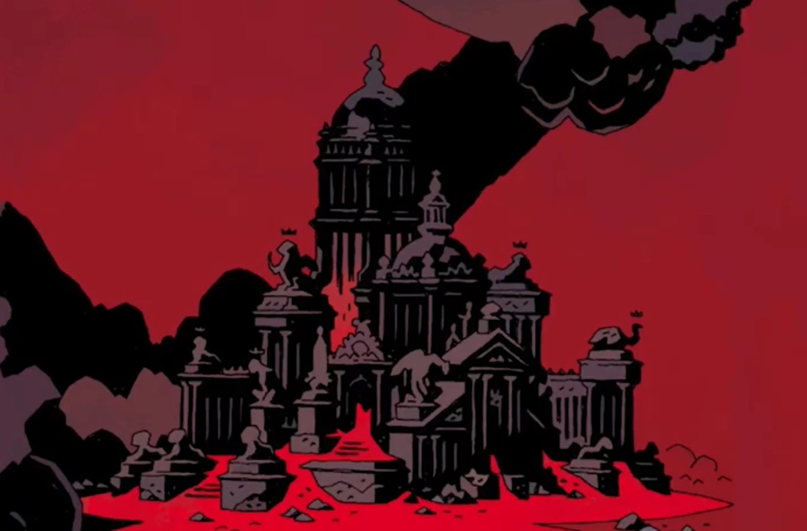

**万魔殿（Pandemonium）**是[地狱](/entry/Hell)的首府，[撒旦](/entry/Satan)与[阿斯塔罗斯](/entry/Astaroth)的居所。

## 历史

万魔殿建于撒旦与普鲁托两派堕落天使之间的千年战争之后，[普鲁托](/entry/Pluto)及其麾下的[守望者](/entry/Watchers)在这场战争中落败。战败的守望者们建造了万魔殿，这座宫殿在他们的背上拔地而起。

## 画廊

地狱男爵第一次品尝煎饼时，万魔殿的恶魔们陷入恐慌。

|
## 灵感来源

万魔殿的灵感显然来自约翰·弥尔顿史诗《失乐园》中的万魔殿（Pandæmonium），它由追随魔鬼对抗上帝的三分之一堕落天使所建造。
