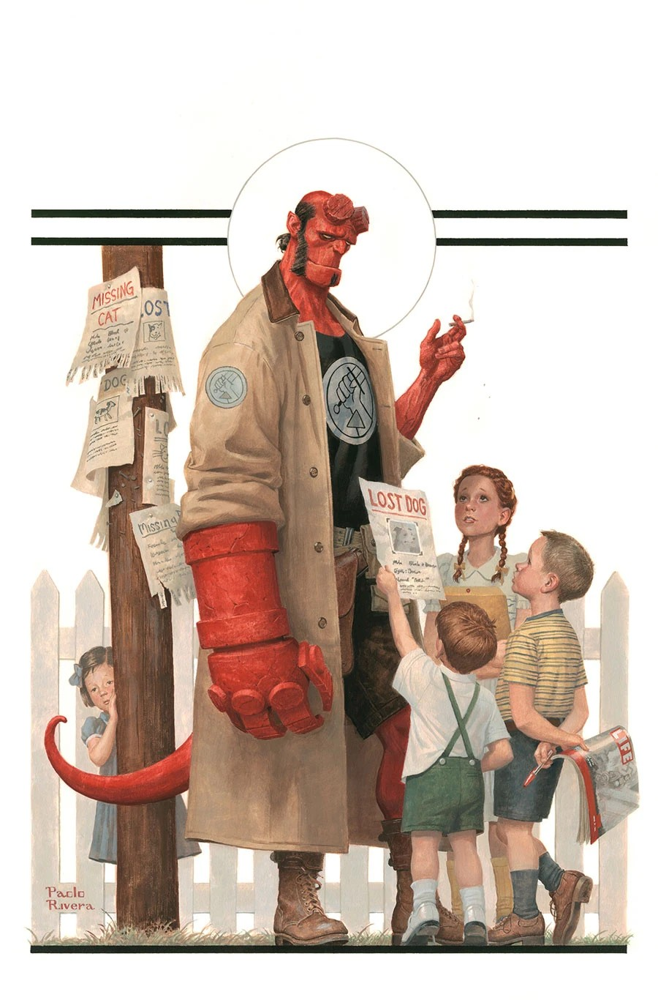
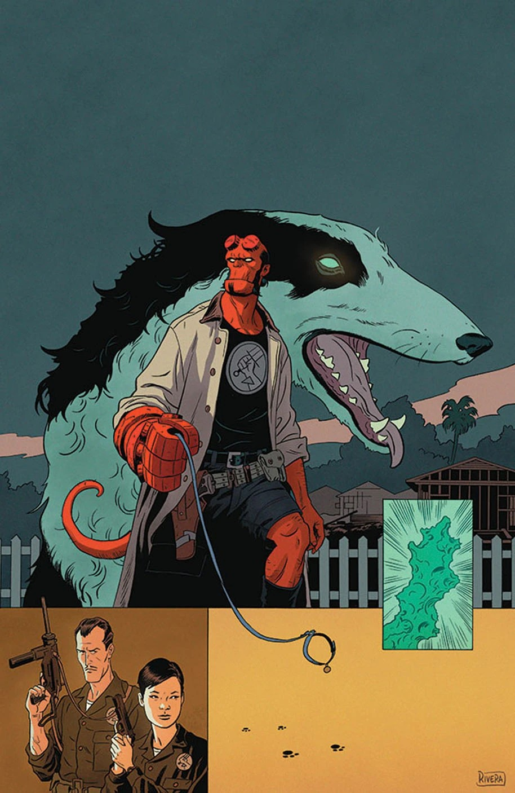
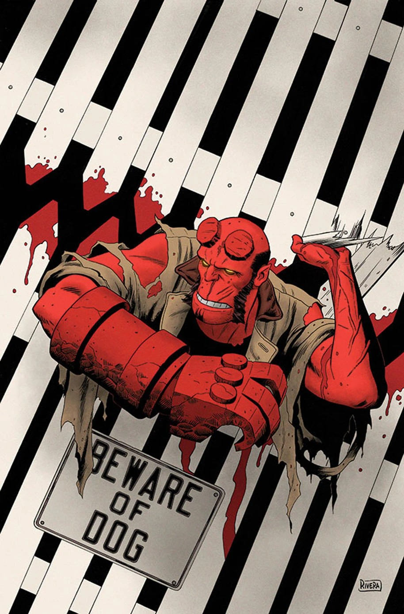
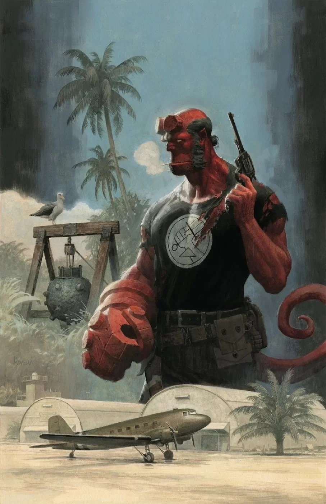
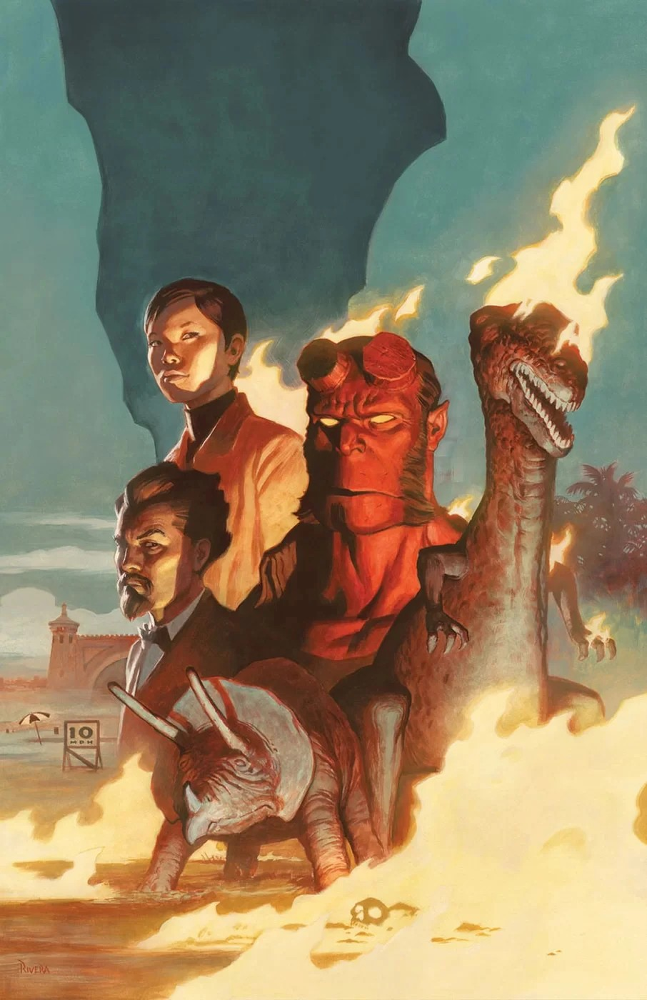
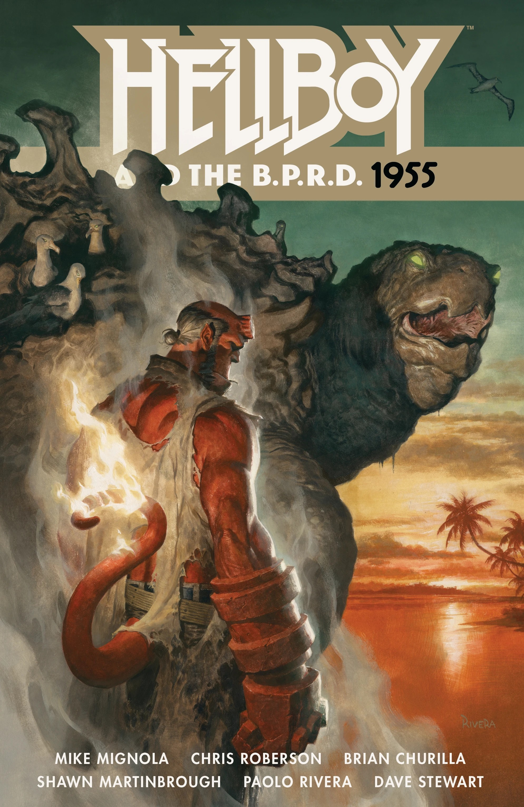

**Paolo Rivera** 是美国漫画画师。他通常与父亲 [Joe Rivera](/entry/Joe_Rivera) 合作，由父亲为他的铅笔画稿勾墨线。

## 内页作画

- *[《地狱男爵与 B.P.R.D.：1953——围栏之外》（Hellboy and the B.P.R.D.:1953—Beyond the Fences）](/entry/Beyond_the_Fences)*
- *[《地狱男爵与 B.P.R.D.：1955——燃烧的季节》（Hellboy and the B.P.R.D.:1955—Burning Season）](/entry/Burning_Season)*

## 封面作画

### 《地狱男爵与 B.P.R.D.》各期

### 《地狱男爵与 B.P.R.D.》合订本

## 外部链接

- **[Wikipedia：](https://en.wikipedia.org/wiki/Paolo_Rivera)**[Paolo Rivera](https://en.wikipedia.org/wiki/Paolo_Rivera)

## 画廊

|Beyond the Fences #1

|Beyond the Fences #2

|Beyond the Fences #3

|Occult Intelligence #1

|Burning Season

|Hellboy and the B.P.R.D.: 1955
