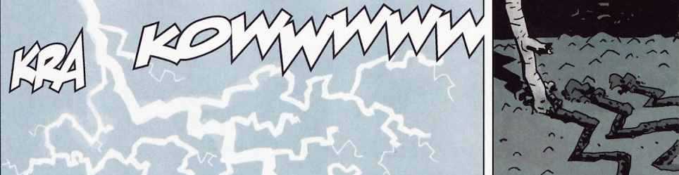
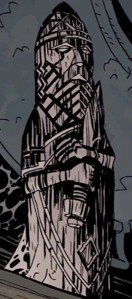
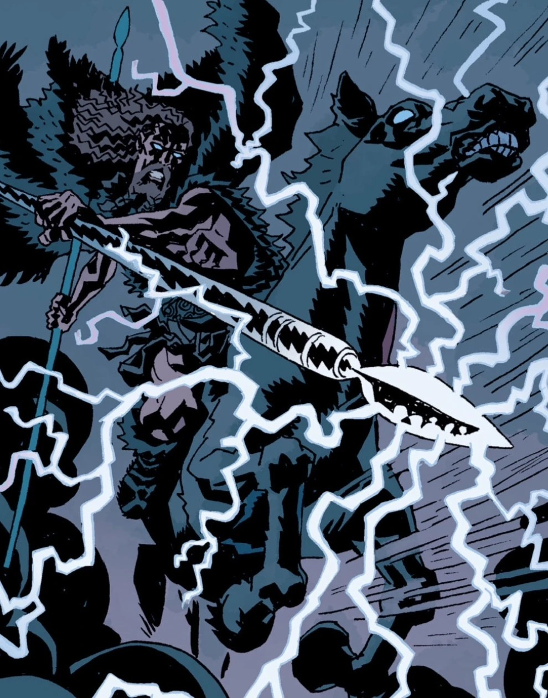
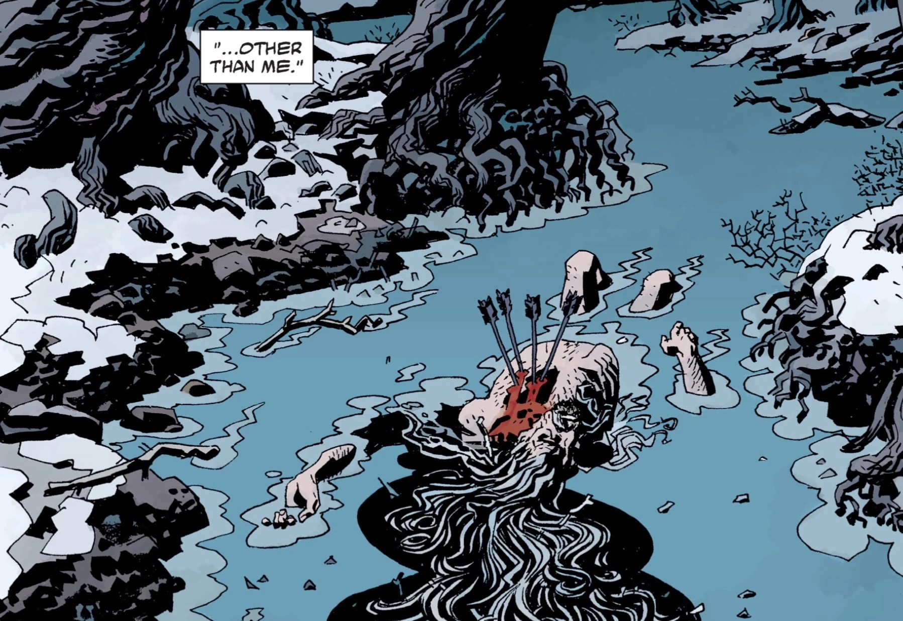

**佩伦（Perun）**是斯拉夫神话中一位古老的[神祇](/entry/Deities)，是斯拉夫万神殿的至高神与主宰。他司职闪电与雷霆。

## 历史

### [黑暗召唤](/entry/Darkness_Calls)

2007 年，[地狱男爵](/entry/Hellboy)因拒绝成为地上女巫之王，被交给[雅加婆婆](/entry/Baba_Yaga)。雅加婆婆把地狱男爵困在一个由她掌控的平行维度里，企图用她支配的不死军队消灭他。地狱男爵从大军手中获救，全靠一群巨狼介入——狼群的统治者[列希（Leshii）](/entry/Leshii)提出让地狱男爵在他的树林里避难一晚。

在此期间，雅加婆婆招募了[不死者科西切](/entry/Koshchei_%28character%29)——一名杀不死的古老战士——去追杀地狱男爵，至少也要为她取回他的眼睛。地狱男爵熟睡时，列希召唤佩伦帮忙，阻止雅加婆婆的军队侵入他的领地。佩伦响应了他的请求，摧毁了雅加婆婆的大军。作为报复，雅加婆婆找到佩伦并杀死了他，因为他通过制造风暴阻碍科西切的进程来帮助地狱男爵。

## 能力

作为古老万神殿中的至高异教神，佩伦是一个强大得难以置信的存在，但多年来由于得不到足够的承认或崇拜而衰弱。即便如此，他依然足够强大——只需用一根树枝在泥土上画出闪电的图形，就能召来雷暴。

## 画廊

Perun's Power 001.png PerunStatue.jpeg PerunThunderByDuncan FegredoMikeMignola.jpeg PerunDeadByDuncanFergado.jpeg

|

|

|

|
