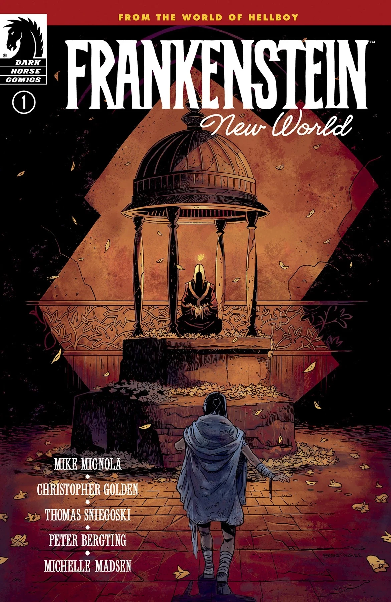
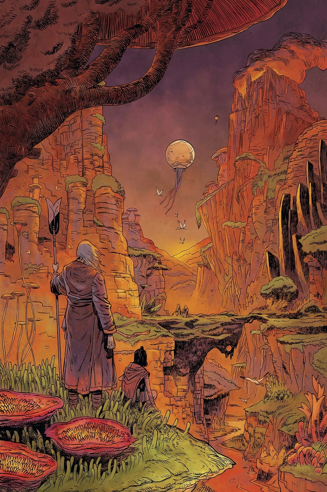
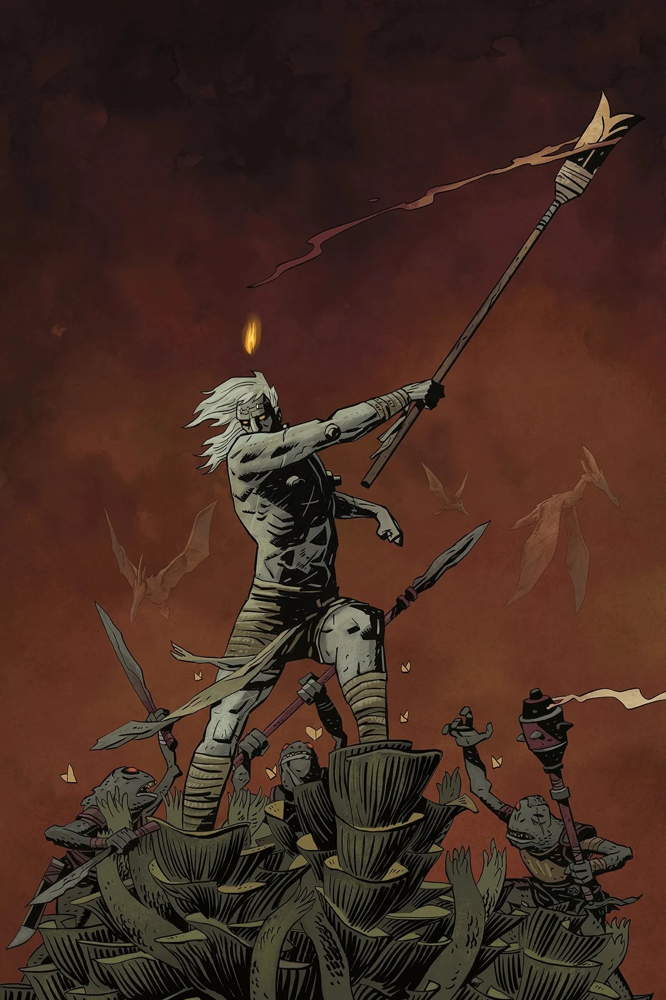
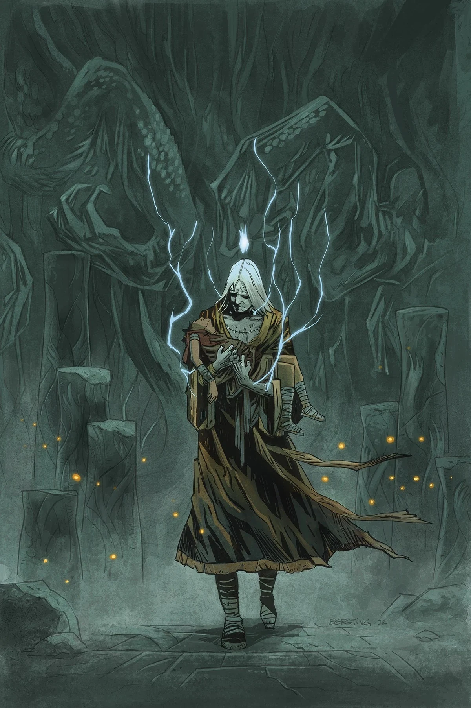
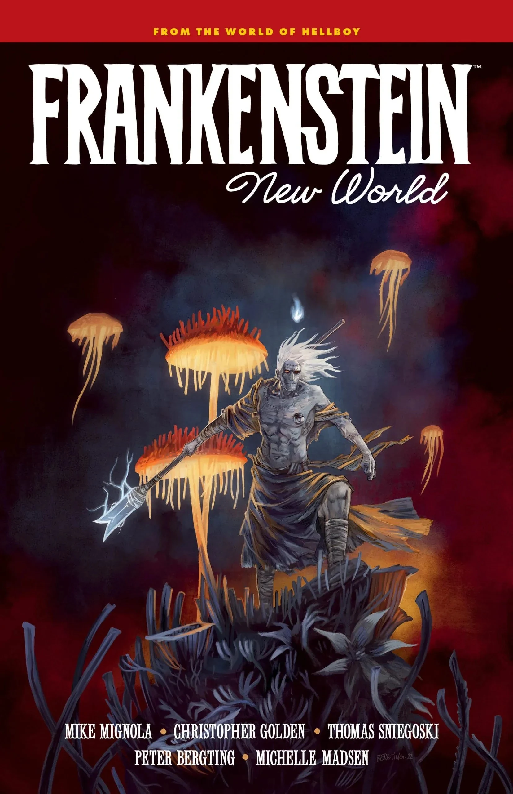

**Peter Bergting** 是一名瑞典作家兼画师。他于 2002 年参与制作 *[《地狱男爵资料设定集与角色扮演游戏》](/entry/Hellboy_Sourcebook_and_Roleplaying_Game)*，由此在地狱男爵宇宙中首次登场。他与 [Mike Mignola](/entry/Mike_Mignola)、[Christopher Golden](/entry/Christopher_Golden) 的合作大多集中在 *The Outerverse*。2022 年，他凭借 *[《弗兰肯斯坦：新世界》](/entry/New_World_(Frankenstein_story_arc))* 首次进入正史地狱男爵宇宙。

## 内页作画

- *[《The Astromagnet》](/entry/The_Astromagnet)*，收录于 *《地狱男爵资料设定集与角色扮演游戏》*
- *[《弗兰肯斯坦：新世界》](/entry/New_World_(Frankenstein_story_arc))*

## 封面作画

*《弗兰肯斯坦：新世界》* \#1

*《弗兰肯斯坦：新世界》* \#2

*《弗兰肯斯坦：新世界》* \#3

*《弗兰肯斯坦：新世界》* \#4

*《弗兰肯斯坦：新世界》*

## 上色师

- *[《The Kabandha》](/entry/The_Kabandha)*，收录于 *《地狱男爵资料设定集与角色扮演游戏》*

## 外部链接

- Bergting.com

## 画廊

|Frankenstein: New World #1

|Frankenstein: New World #2

|Frankenstein: New World #3

|Frankenstein: New World #4

|Frankenstein: New World
