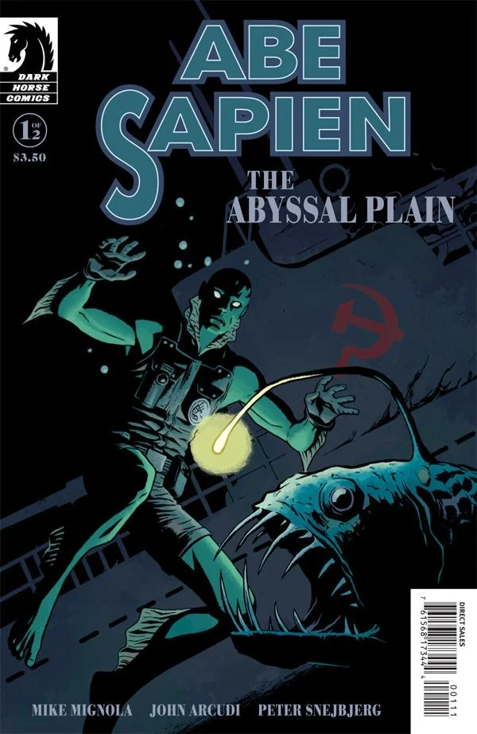

**Peter Snejbjerg Nielsen** 是丹麦漫画画师。他的主要作品包括史诗科幻／奇幻系列 *Hypernauten*、冒险故事 *The Hidden Protocol*（Den Skjulte Protokol）、DC Comics 旗下的 *Starman*，以及多部 Vertigo 作品。

### 内页画师

- [《B.P.R.D.：蛙族之战》 #4](/entry/War_on_Frogs)
- [《鱼人亚伯：深渊平原》](/entry/The_Abyssal_Plain)
- [《B.P.R.D.：人间地狱——地狱寒日》](/entry/A_Cold_Day_in_Hell)
- [《B.P.R.D.：人间地狱——无处、虚无、永不》](/entry/Nowhere%2C_Nothing%2C_Never)
- [《Lobster Johnson：被遗忘的人》](/entry/The_Forgotten_Man)

### 封面画师

## 外部链接

- [**维基百科：Peter Snejbjerg**](https://en.wikipedia.org/wiki/Peter_Snejbjerg)
- [**Comic Book DB：Peter Snejbjerg**](http://comicbookdb.com/creator.php?ID=283)
- [Peter Snejbjerg 的官方博客](http://www.snejbjerg.com/)

## 画廊

|Abe Sapien: The Abyssal Plain #1 variant
