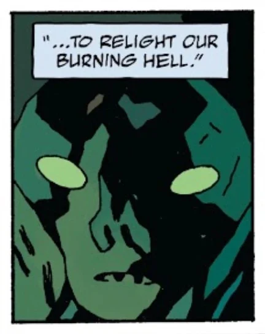

**普鲁托（Pluto）**是[地狱](/entry/Hell)的昔日统治者，在[撒旦](/entry/Satan)及其恶魔崛起之前统治着那里。在罗马文化中，他被视为冥界之主。他首次登场于[《丧钟为谁而鸣》](/entry/For_Whom_the_Bell_Tolls)。

在地狱男爵的故事中，他基本上是一个未曾露面的人物，但剧情暗示他将在[奥古·桀哈](/entry/Ogdru_Jahad)之后的世界中担任主要反派。

## 历史

### 起源

普鲁托最初是[守望者](/entry/Watchers)之一，因创造[奥古·桀哈](/entry/Ogdru_Jahad)而被逐出尘世。他被任命为被判入地狱的守望者的首领。

天使第二次坠落之后，撒旦及其追随者被投入深渊，在那里与普鲁托的追随者展开了一场持续千年的战争。撒旦最终获胜，宣布地狱为自己的王国。第一次天使坠落中残存的守望者们沦为奴隶，被迫修建[万魔殿](/entry/Pandemonium)。普鲁托是唯一逃入[深渊](/entry/Abyss)的守望者。

### [《丧钟为谁而鸣》](/entry/For_Whom_the_Bell_Tolls)

[地狱男爵](/entry/Hellboy)在睡梦中谋杀撒旦后，地狱之王的死引发了一场奴隶叛乱，几乎将恶魔统治阶层的大多数成员尽数消灭。幸存的恶魔领主们聚集到地狱边缘的别西卜城堡。出于对自身安危和地狱之火日渐衰微的担忧，别西卜提议召来普鲁托，让他接替撒旦之位、重建秩序。但寻找这位前地狱之王的计划始终未能实施，因为恶魔领主们在地狱男爵与一群复仇奴隶的联合进攻下被屠戮殆尽。[1]

### [《不死的 Koschei》](/entry/Koshchei_the_Deathless)

地狱男爵在地狱遇到正在寻找失落灵魂的[柯歇伊](/entry/Koshchei_%28character%29)时，警告他普鲁托仍在逃。[2]

### [《Acheron》](/entry/Acheron_%28story%29)

仍被囚禁在[塔尔塔罗斯](/entry/Tartarus)的普鲁托主动联系[埃利戈斯](/entry/Eligos)，提出赐予他力量，换取这位恶魔骑士解救自己。埃利戈斯答应为他的归来铺路，并打算用新获得的力量杀死[爱德华·格雷](/entry/Edward_Grey)。然而，格雷接纳了自己的恶魔本性，化作[阿刻戎河](/entry/Acheron_%28river%29)的化身，击败了他的勇士。[3]

### [《Koschei 在地狱》](/entry/Koshchei_in_Hell)

爱德华·格雷爵士担心普鲁托即将卷土重来、毁灭一切生灵，恳求[柯歇伊](/entry/Koshchei_%28character%29)阻止他。这位斯拉夫战士最终答应了；他从地狱男爵的吸血鬼新娘那里得知，[加莫利](/entry/Gamori)在撒旦尸体旁发出的尖叫唤醒了普鲁托，他正在归来的路上。

## 能力

据[别西卜](/entry/Beelzebub)所说，普鲁托有能力用他那颗冰冷的心重燃地狱之力。他还统率着[复仇三女神](/entry/Erinyes)，她们负责追查并惩罚那些逃脱了制裁的凡人和神祇。[4] 他很可能是所有守望者与恶魔之中实力第三强者，仅次于撒旦和阿努姆。

## 画廊

PlutoCloseupByMikeMignola.jpg

|
## 参考资料

[1] *[《Hellboy in Hell》](/entry/Hellboy_in_Hell)* 第 10 期

[2] *[《Koshchei the Deathless》](/entry/Koshchei_the_Deathless)* 第 6 期

[3] *[《Acheron》](/entry/Acheron_%28story%29)*

[4] *[《Hellboy in Hell》](/entry/The_Hounds_of_Pluto)* 第 8 期
