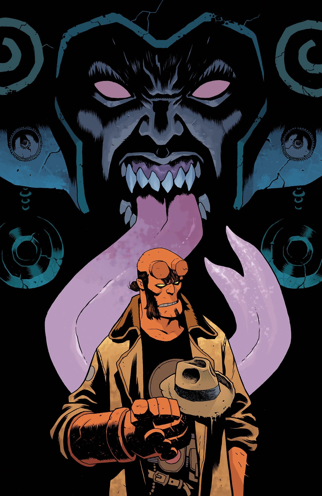

***《哈维教授不见了》（Professor Harvey Is Gone）*** 是一部 *[《地狱男爵与超自然调查防御署》](/entry/Hellboy_and_the_B.P.R.D.)* 单期完结故事，由 [Mike Mignola](/entry/Mike_Mignola) 与 [Christopher Golden](/entry/Christopher_Golden) 编剧，[Giuseppe Manunta](/entry/Giuseppe_Manunta) 作画，这也是他在地狱男爵宇宙中的首次亮相。该故事松散改编自散文短篇 *[《海中城》](/entry/The_City_in_the_Sea)*（The City in the Sea），原作由 Mike Mignola 与 [Christopher Golden](/entry/Christopher_Golden) 创作。

## 剧情简介

一位偏执多疑的古董教授失踪后，地狱男爵与超自然调查防御署迅速行动，但追查过程急转直下、凶险万分——因为一直追踪教授的人，又把目标对准了地狱男爵。

## 画廊

*《地狱男爵与超自然调查防御署：哈维教授不见了》*  
封面：Giuseppe Manunta

*《地狱男爵与超自然调查防御署：哈维教授不见了》*  
变体封面：Mike Mignola  
上色：Dave Stewart

*《地狱男爵与超自然调查防御署：哈维教授不见了》*  
Nirvana Comics 独家变体封面：Ben Stenbeck

|Hellboy and the B.P.R.D.: Professor Harvey Is Gone Nirvana Comics exclusive variant cover by Ben Stenbeck
