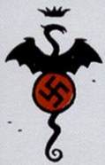

拉格纳洛克计划标志。

**拉格纳洛克计划（Project Ragna Rok）**是一个由[格里高利·拉斯普廷](/entry/Grigori_Rasputin)领导的纳粹神秘学计划，以北欧神话中那场终局之战命名，旨在制造一件末日武器，以期结束第二次世界大战、为纳粹德国带来胜利。

## 概述

第二次世界大战末期，面对可能战败的局面，阿道夫·希特勒启动了众多「末日」计划，企图通过科学或神秘学手段为纳粹带来胜利。拉格纳洛克（意为「致命的命运」）计划便是其中之一。格里高利·拉斯普廷在意大利冥想期间，[海因里希·希姆莱](/entry/Heinrich_Himmler)找上了他，请他率领一群纳粹神秘学者制造大规模杀伤性武器。最终，拉斯普廷看中了[伊尔莎·豪普斯坦](/entry/Ilsa_Haupstein)、[利奥波德·克茨](/entry/Leopold_Kurtz)和[卡尔·鲁普雷希特·克焰宁](/entry/Karl_Ruprect_Kroenen)的潜力，把他们招入自己的拉格纳洛克计划。

拉斯普廷向希特勒许诺会带来扭转战局的「奇迹」。而在暗地里，拉斯普廷其实希望触发一场末日浩劫，以此开启一个新的伊甸园。

1944 年 12 月 23 日，在苏格兰海岸外的小岛塔马甘特岛上，拉格纳洛克计划进入最后阶段。拉斯普廷从地狱中召唤来了开启末日浩劫的钥匙。然而意外发生了：钥匙并没有出现在塔马甘特岛，而是出现在英格兰东布罗姆维奇一座废弃的教堂里。更糟的是，这把钥匙——一个幼魔巨大的石质右手——被盟军寻获。这个恶魔后来成了[地狱男爵](/entry/Hellboy_%28character%29)，而他的右手在此后令无数人觊觎。希特勒派驻该计划的联络官[克劳斯·维尔纳·冯·克虏伯](/entry/Klaus_Werner_von_Krupt)认定计划失败，团队随即正式解散。拉斯普廷动身前往北极圈，追寻一座失落已久的[奥古·桀哈](/entry/Ogdru_Jahad)神庙；豪普斯坦、克茨和克焰宁则把自己低温冷冻起来，等待拉斯普廷再次需要他们。

## 团队成员

### [克劳斯·维尔纳·冯·克虏伯](/entry/Klaus_Werner_von_Krupt)

希特勒派驻该计划的联络官。冯·克虏伯相信拉斯普廷关于奇迹的许诺，但怀疑这个僧侣是否有能力兑现。他对拉斯普廷的真实动机一无所知，在看不到成果后便宣布计划失败。冯·克虏伯被送入艾森瓦尔特疗养院六个月后死去。人们发现他的尸体里寄居着大量种类与来历不明的甲虫。

### [利奥波德·克茨](/entry/Leopold_Kurtz)

一名年轻的纳粹神秘学者，把自己的命运押在了拉斯普廷和拉格纳洛克计划上。拉斯普廷在卡文迪什庄园失败后，克茨与克焰宁、豪普斯坦一同转移到挪威的一处基地。当[罗德里克·津科](/entry/Roderick_Zinco)找到了[赫尔曼·冯·卡朗普特](/entry/Herman_von_Klempt)被砍下的头颅时，克茨对把冯·卡朗普特拉入他们的计划表示反对。后来克茨撞见那颗头颅正与克焰宁密谋叛国，便出手攻击头颅。克焰宁冲上去保护老朋友，却失手将克茨刺死。

### [伊尔莎·豪普斯坦](/entry/Ilsa_Haupstein)

伊尔莎是拉斯普廷为拉格纳洛克计划招募的另一名纳粹科学家，表现出极度的虔诚与忠诚。拉斯普廷的灵魂从卡文迪什庄园的失败中归来后，她帮忙设计把地狱男爵送入赫卡特和吸血鬼朱雷斯库伯爵手中。为了表明自己对拉斯普廷的信仰，她把自己关进一具神秘的铁处女（刑具）中，当即殒命。伊尔莎的鲜血为铁处女提供了能量，这在一定程度上使赫卡特在被地狱男爵杀死后得以残存。

### [卡尔·鲁普雷希特·克焰宁](/entry/Karl_Ruprect_Kroenen)

始终戴着面具的克焰宁曾与赫尔曼·冯·卡朗普特一同上大学。他被拉斯普廷招募加入拉格纳洛克计划，在塔马甘特岛的惨败之后与伊尔莎、克茨一同冷冻自己，并在卡文迪什庄园事件后重新现身。克焰宁与克茨、津科合作，直到津科发现了冯·卡朗普特的头颅。出于对老同僚的同情，克焰宁听任冯·卡朗普特怂恿自己背叛拉斯普廷。克茨偷听到后攻击头颅，迫使克焰宁杀死了他。这招致拉斯普廷亡魂的报复，最终以一场剧烈的爆炸收场，津科和克焰宁双双毙命。

### [格里高利·拉斯普廷](/entry/Grigori_Rasputin)

1916 年 12 月 16 日被 Felix Yusopov 亲王刺杀后，拉斯普廷被奥古·桀哈复活并与之接触。它们把他招募为自己在世间的凡人代理人。不久之后，纳粹联系上拉斯普廷，要他着手研究一种结束战争的神秘学方法。拉格纳洛克计划由此诞生。纳粹想利用拉斯普廷击败盟军，但拉斯普廷知道这永远不会发生。他只是打算尽可能长久地借用纳粹的资源来实现自己的目标：触发末日浩劫，以此开启一个新的伊甸园。

尽管纳粹认为他失败了，拉斯普廷却清楚自己在 23 日夜里已经召唤来了地狱。由于地狱男爵落入盟军手中，他花了许多年才营造出能利用地狱男爵召唤奥古·桀哈的局面。拉斯普廷在卡文迪什庄园一度得手，但最终被挫败。他又强令地狱男爵与赫卡特对峙，试图再试一次，但地狱男爵摧毁了赫卡特的凡人身躯，拉斯普廷的亡魂只得退去。一段时间之后，赫卡特找到了他四处游荡的灵魂，告诉他自己不过是奥古·桀哈手中的一枚棋子。拉斯普廷勃然大怒，向她发起攻击，几乎被彻底毁灭。雅加婆婆把他灵魂的一小片保存在一颗她挂在脖子上的橡果里。

## 盟友

### [罗德里克·津科](/entry/Roderick_Zinco)

富有的实业家罗德里克·津科被选为拉斯普廷与拉格纳洛克计划成员之间的信使。在差点被利奥波德·克茨杀死之后，津科的一个线人设法弄到了赫尔曼·冯·卡朗普特那颗脱离身体的头颅。拉斯普廷为此震怒，摧毁了拉格纳洛克基地，津科和克焰宁一同丧命。

### [赫尔曼·冯·卡朗普特](/entry/Herman_von_Klempt)

### [非人](/entry/Unmensch)

非人为伊尔莎·豪普斯坦效力，是一名生化纳粹超级士兵。他在协助豪普斯坦寻找[弗拉基米尔·朱雷斯库](/entry/Vladimir_Giurescu)遗体时与地狱男爵交战。打斗中两人一起跌穿地板，非人在此过程中失去了一条手臂。非人消失不见，但他那颗脱离身体的头颅后来在朱雷斯库的棺材旁被发现。

## 其他媒体

### 真人电影

在[《地狱男爵》（2004 年电影）](/entry/Hellboy_%282004_film%29)中，该计划于 1944 年在[特隆厄姆修道院](/entry/Trondham_Abbey)进行，地点是[苏格兰](/entry/Scotland)海岸外的一座小岛。由于修道院建在一条[地脉](/entry/Ley_line)的交汇点上，由[冯·克虏伯](/entry/Klaus_Werner_von_Krupt)将军、[克焰宁](/entry/Karl_Ruprect_Kroenen)上校、[伊尔莎·豪普斯坦](/entry/Ilsa_Haupstein)和[格里高利·拉斯普廷](/entry/Grigori_Rasputin)率领的一队纳粹科学家与士兵试图在此打开一道传送门。他们希望唤醒[奥古·桀哈](/entry/Ogdru_Jahad)，为[希特勒](/entry/Adolf_Hitler)带来奇迹并创造一个新的伊甸园。然而，[特雷佛·布鲁姆](/entry/Trevor_Bruttenholm)教授和[乔治·惠特曼](/entry/George_Whitman)中士率领一支队伍登上了小岛。惠特曼的士兵们发起进攻，与克焰宁及其士兵交战。与此同时，布鲁姆成功向传送门的发生器掷出了一枚手榴弹。克焰宁试图抓住手榴弹，但没能阻止它使传送门关闭。克焰宁失去了左手，被甩到一根柱子上，一根钢筋贯穿了他的脊椎。拉斯普廷被吸入传送门，据说再度殒命。不过克焰宁活了下来，与豪普斯坦一同逃脱。尽管传送门已经关闭，布鲁姆仍让惠特曼和士兵们搜查地面。布鲁姆和一名士兵发现了一个恶魔。惠特曼的士兵和布鲁姆带走了他，并给他取名为[地狱男爵](/entry/Hellboy_%282004%E2%80%932008_film_character%29)。布鲁姆后来成了他的养父。

克焰宁和豪普斯坦成功躲藏了 60 年。两人联手在 2004 年把拉斯普廷带了回来。
