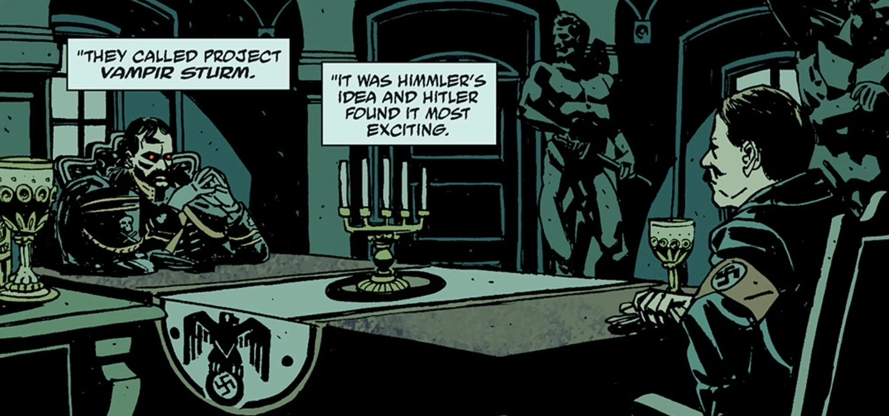

**Vampir Sturm 计划**是 [海因里希·希姆莱（Heinrich Himmler）](/entry/Heinrich_Himmler)一手炮制的纳粹末日实验，目的是组建一支吸血鬼大军。

## 历史

Vampir Sturm 计划由希姆莱提出，并于 1944 年 10 月获得[阿道夫·希特勒（Adolf Hitler）](/entry/Adolf_Hitler)批准。希姆莱派出一支由[伊尔莎·豪普斯坦（Ilsa Haupstein）](/entry/Ilsa_Haupstein)率领的纳粹代表团，前往罗马尼亚的朱雷斯库城堡，招募[弗拉基米尔·久雷斯库](/entry/Vladimir_Giurescu)为德国的战争机器效力。1944 年 12 月，朱雷斯库亲自与希特勒会面，但这次会面让希特勒意识到，一支由这种生物组成的军队将完全无法控制。朱雷斯库和随行的新娘们随即被捕并处决。豪普斯坦与朱雷斯库的新娘们一样深深爱上了他，因此痛不欲生；尽管她对纳粹理想的忠诚依然坚定，但她把希特勒斥为一个可悲的弱者，说他不过是惧怕被朱雷斯库的伟大光芒盖过。

然而，Vampir Sturm 计划并未被放弃，而是得到了改良。朱雷斯库的新娘之一安娜被彻底抽干血液，她的血被送往柏林一家实验室，藏在里特精神病院（Ritter Institute for the Mentally Unstable）的地下。纳粹试图用这些血制造可以被控制的吸血鬼混血体——与朱雷斯库造出的吸血鬼不同。最初的实验对象是从隶属于“狼人”（*Werwolf*）游击队师的党卫队（*Schutzstaffel*）中精挑细选的九名成员。不幸的是，五人当场死亡，剩下四人则畸变成疯狂、丑陋的野兽。

纳粹方面承认，打造能够扭转战局的吸血鬼士兵已毫无希望，于是最后一次调整了 Vampir Sturm 计划：制造一大批这种野兽，一旦德国落入同盟国之手，就将它们放出去在世界上肆虐。1945 年 1 月，里特精神病院里最强壮的 120 名病人被注射了吸血鬼血液，并在转化进行到一半时用液氮冷冻起来。

1945 年 4 月 30 日，苏联军队逼近柏林，希特勒命令[弗雷德里希·曼施泰因（Frederich Manstein）](/entry/Frederich_Manstein)将军解冻 Vampir Sturm 计划的实验体。然而，已经看清纳粹罪行的曼施泰因违抗了命令，反而封死了关押吸血鬼的房间，并在精神病院的档案中留下一封解释自己决定的信。

1946 年，[赫尔曼·冯·卡朗普特](/entry/Herman_von_Klempt)博士找回了这些冷冻的吸血鬼，把它们装上一枚火箭射向美国。这一阴谋被[特雷佛·布鲁姆](/entry/Trevor_Bruttenholm)以及恶魔[瓦尔瓦拉](/entry/Varvara)麾下的一小队美苏联军挫败，吸血鬼也在冯·卡朗普特的火箭随后发生的爆炸中被彻底消灭。

## 画廊

希特勒会见朱雷斯库。

|Hitler meets Giurescu.
## 另请参见

- [诸神黄昏计划](/entry/Project_Ragna_Rok)
