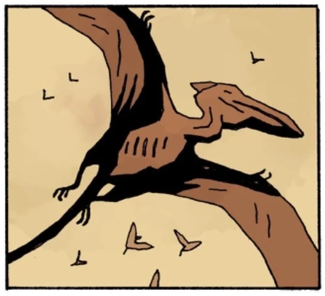

**翼龙（Pterosaur）**是地球远古时代的飞行爬行动物，长期以来被认为已经灭绝。人类并不知道，在地下深处的桑克蒂·许贝鲁姆（Sancti Hyperberum），至少还有一个物种存活。

## 出场

- [*《弗兰肯斯坦：地下》*](/entry/Frankenstein_Underground)

<!-- -->

- [*《诸神黄昏（Ragna Rok）》*](/entry/Ragna_Rok_(story_arc))
