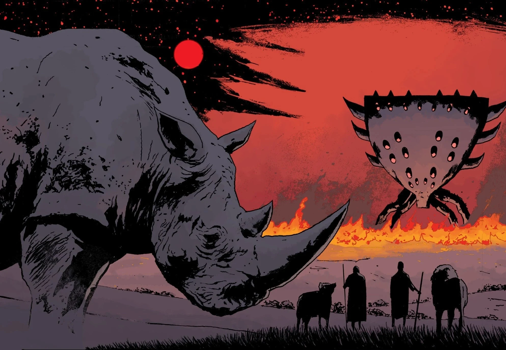
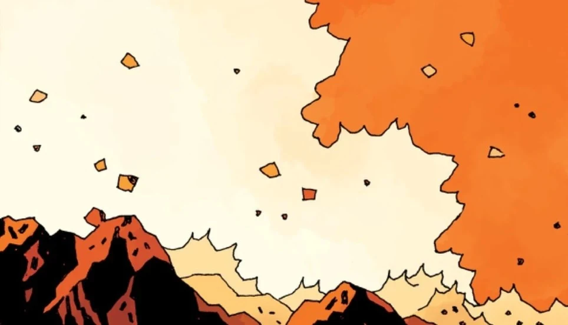
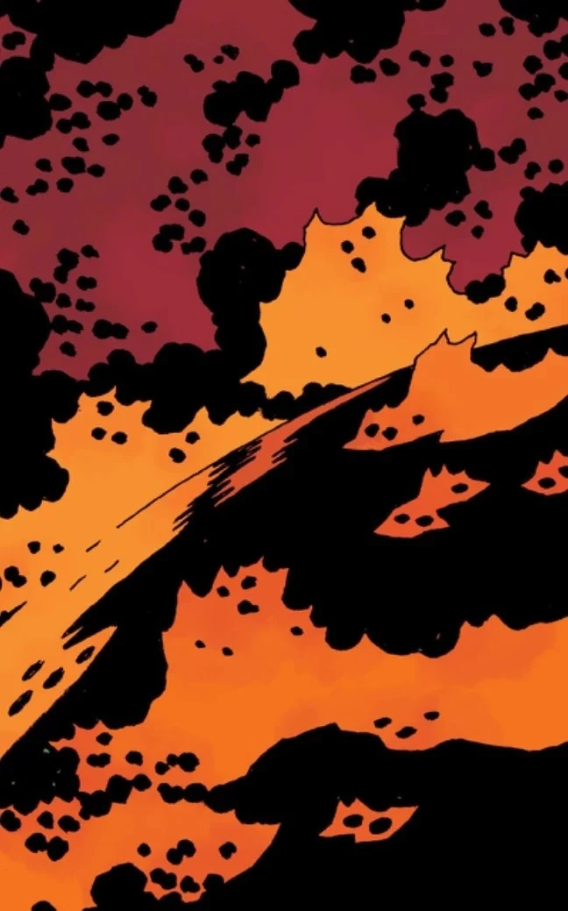
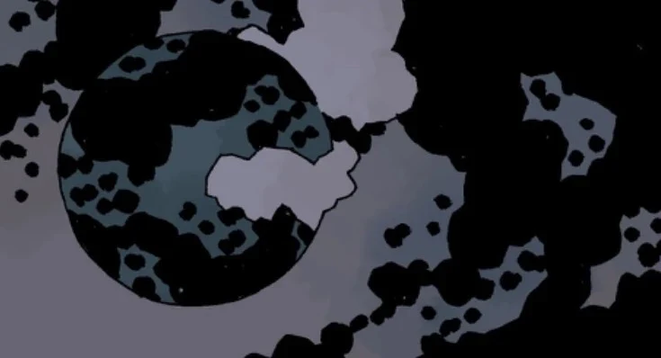

**拉格纳·洛克**(Ragna Rok)是命中注定的世界末日，它与[地狱男爵](/entry/Hellboy_(character))、[毁灭之右手](/entry/Right_Hand_of_Doom)以及[奥古·桀哈](/entry/Ogdru_Jahad)紧密相连。

## 预言

尽管系列中的许多角色都知晓世界末日的预言，但他们对预言究竟会如何应验有着各式各样的解读，其中也有若干共通的要素。最普遍的说法是：奥古·桀哈一旦获释，世界将被烈火吞噬，化为灰烬。有人认为，它们的获释将由人类的灭绝所触发（无论是死于奥格德鲁·赫姆之手还是其他原因）；也有人认为巨龙将先被释放，再由它亲手毁灭人类。因此，系列中的许多反派都试图依照这些解读采取行动，或推动末日降临，或设法阻止它。另有一些人预见到，奥格德鲁·赫姆会在世界被烈火吞噬之前统治世界。只有拉斯普廷、赫卡特和仙灵等少数存在，看到了劫后将会崛起的新世界，以及随之而来的第三个、也是最后一个人类种族。赫卡特无法窥见更远的未来——她只能看到自己与地狱男爵并肩立于世界尽头的那一刻，无法确定他们是会在未来世界中扮演某种角色，还是仅仅一同赴死。

## 终焉与开端

末日的真正应验揭示了最终的结局。拉斯普廷死而复生，成为奥古·桀哈的宿主，令奥格德鲁·赫姆在世界各地化身现身、重新苏醒，恢复全部力量。地狱男爵与亚伯·塞皮恩都死于拉斯普廷之手，地狱男爵还失去了毁灭之右手——但在那之前，地狱男爵已将拉斯普廷彻底杀死。奥格德鲁·赫姆确实在地球上迎来了它们的统治时代，恐吓着人类最后的残余，而其余的人类已经逃入了空心地球。随后，奥西里斯俱乐部取走毁灭之右手，用它将奥古·桀哈的水晶囚狱掷向地球，将它们及其子嗣尽数消灭。巨龙们的生命力被导入右手之中，奥西里斯俱乐部企图借此在新世界中登神。然而，地狱男爵的灵魂在他们得逞之前夺回了右手。

复活的地狱男爵立于山巅，与如约前来的赫卡特重聚。在山下，他们望见远处的丽兹·舍曼正神情恍惚地游荡在废土之上。在地狱男爵的催促下，丽兹释放出她全部的火焰，应验了地球被焚为灰烬的预言。赫卡特展开她那铁处女般的形态，将地狱男爵吞入腹中。她把他的鲜血洒下山峦，为世界重新带回了水与生命。从亚伯·塞皮恩破碎的身体中释放出的卵纷纷孵化，带来了继承这个欣欣向荣的新世界的最后一个人类种族。

## 画廊

[迪恩·希](/entry/Daoine_Sidhe)(Daoine Sidhe)在消失的不列颠之岛上见证拉格纳·洛克

拉格纳·洛克中的非洲大灵

丽兹·舍曼燃起烈焰，终焉由此开始。

烈焰吞噬地球。

拉格纳·洛克之后的地球。

|The Great Spirit of Africa at Ragna Rok

|Liz Sherman igintes, beginning the end.

|The flames engulf the Earth.

|Earth after Ragna Rok.
## 登场

- [《拉格纳·洛克》](/entry/Ragna_Rok_(story_arc))
