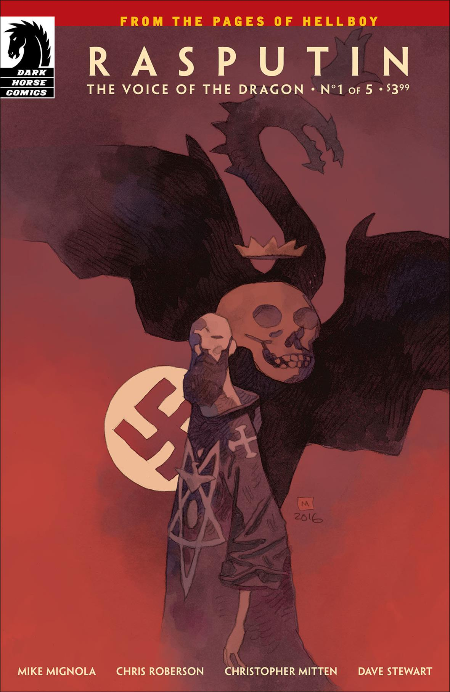
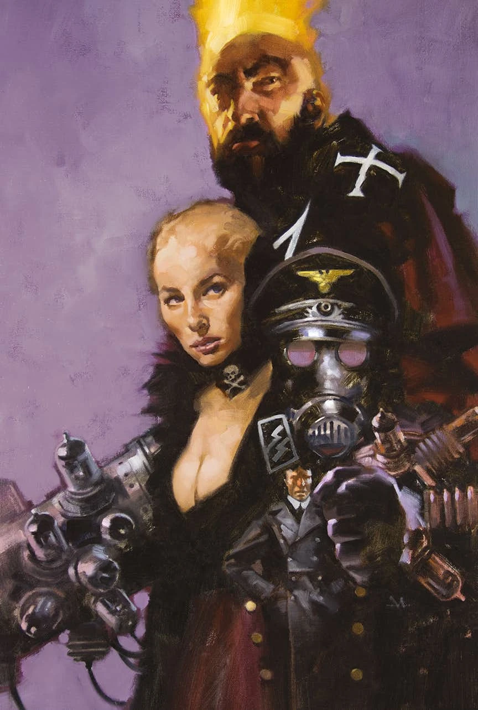
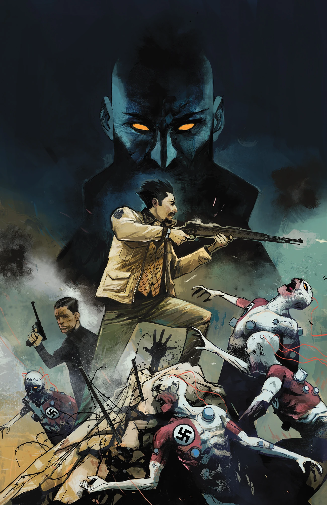
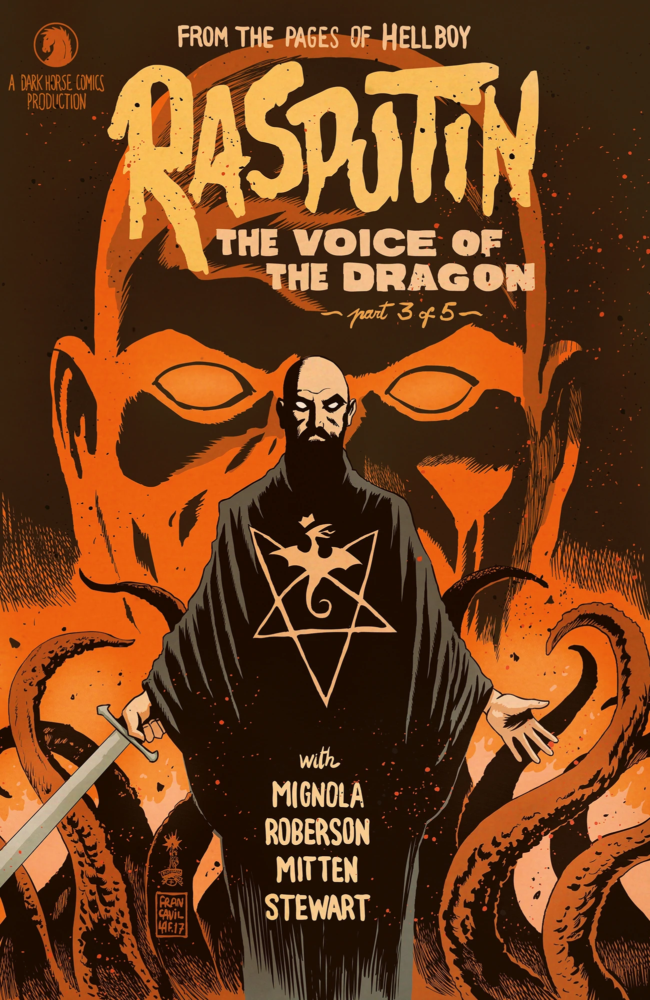
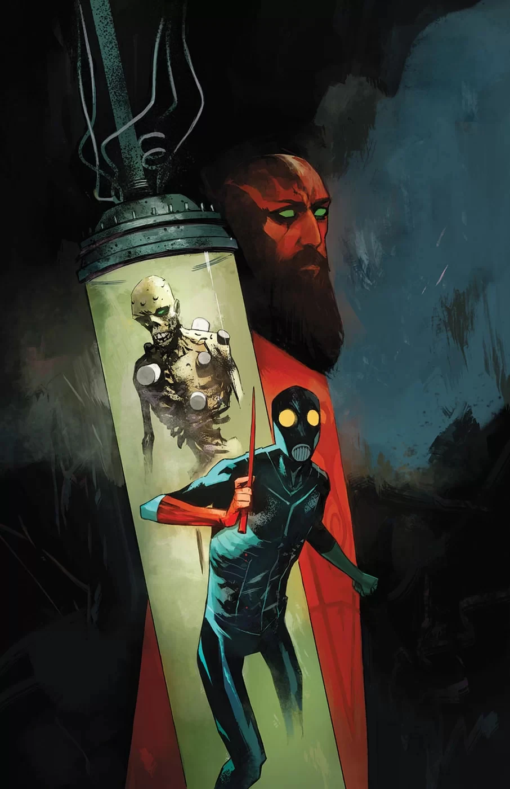
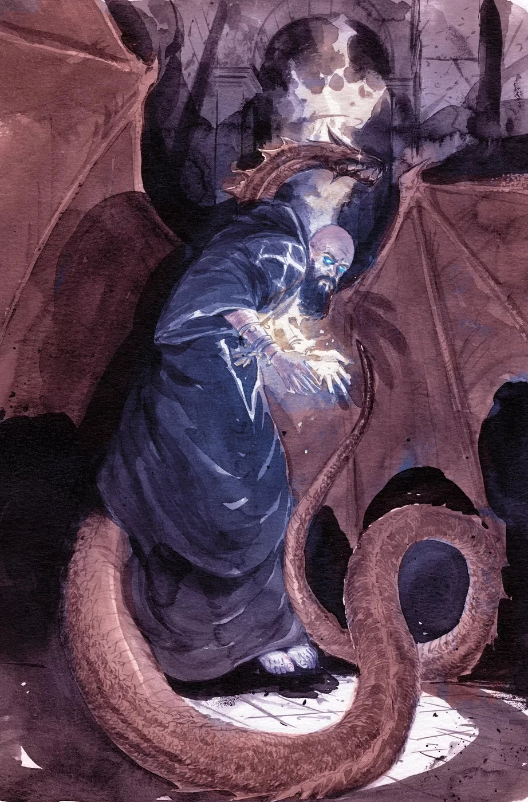
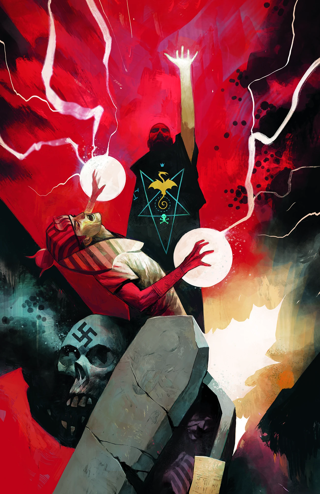

***《拉斯普廷：龙之音》*（Rasputin: The Voice of the Dragon）**是一部五期限定迷你系列，由迈克·米格诺拉（Mike Mignola）和克里斯·罗伯森（Chris Roberson）编剧，克里斯托弗·米滕（Christopher Mitten）绘画。

## 剧情梗概

### 第一部分

一场牵涉第三帝国与一个邪恶秘密社团已故成员的阴谋，将[布鲁滕霍尔姆教授](/entry/Trevor_Bruttenholm)推上了他的第一个任务——找到那个很快就会把[地狱男爵](/entry/Hellboy_%28character%29)带到人间的男人。疯狂的俄国术士[拉斯普廷](/entry/Grigori_Rasputin)自 1916 年起就被认为已经死亡，当时一群贵族试图终结他对沙皇的影响。如今，拉斯普廷与[希特勒](/entry/Adolf_Hitler)核心圈子里最扭曲的成员们合作，而他即将与那个日后创立[超自然现象调查与防御局](/entry/Bureau_for_Paranormal_Research_and_Defense)的男人狭路相逢。

### 第二部分

一场降神会揭示出，布鲁滕霍尔姆的任务可能远超他的预期：赌注变得更加危险，而敌人却只会更加神秘。

### 第三部分

拉斯普廷的盟友们各怀鬼胎、追求各自的目标；与此同时，布鲁滕霍尔姆教授空降到纳粹占领区，搜寻"那位主人"（The Master）。

### 第四部分

布鲁滕霍尔姆和[桑杜](/entry/A.N._Sandhu)肩负任务，要揭开藏在纳粹神秘实验背后、行踪诡秘的"那位主人"，但任务在他们落入敌人魔爪时脱轨。

### 第五部分

布鲁滕霍尔姆和桑杜抵达纳粹神秘活动的现场，那个暗影幢幢的主人本人即将完成他的神秘实验。桑杜被拉斯普廷随手一掌扇到一边，布鲁滕霍尔姆则被[伊尔莎·豪普斯坦因](/entry/Ilsa_Haupstein)击昏。拉斯普廷遭到阿尔伯特·梅休（Albert Mayhew）的背叛，后者企图吸收尤金·雷米（Eugene Remy）陵墓周围结界中的能量。雷米的鬼魂让自己的尸体重新活动，手持一块巨大的金匾现身。他斥责梅休，并将其肉体与灵魂一并焚化，省了拉斯普廷亲手处置他的麻烦。拉斯普廷带着雷米的金匾离开，金匾证实了古人曾听到[奥格德鲁·贾哈德](/entry/Ogdru_Jahad)的声音。桑杜死在布鲁滕霍尔姆的怀中。

## 画廊

除另有署名外，所有封面均由 [迈克·赫德尔斯顿](/entry/Mike_Huddleston) 绘制。

 \#1

 \#1
（迈克·米格诺拉变体版）

 \#2

 \#2
（[格雷戈里·曼切斯](/entry/Gregory_Manchess)变体版）

 \#3

 \#3
（[弗朗切斯科·弗兰卡维拉](/entry/Francesco_Francavilla)变体版）

 \#4

 \#4
（Vanesa R. Del Rey 变体版）

 \#5

 \#5
（[迈克尔·W·卡卢塔](/entry/Michael_W._Kaluta)变体版）
