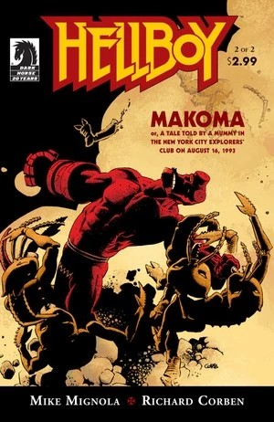
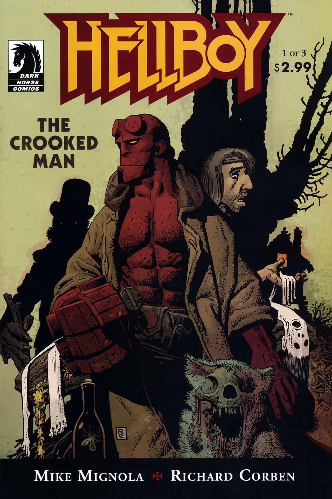
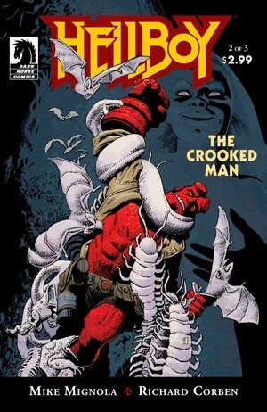
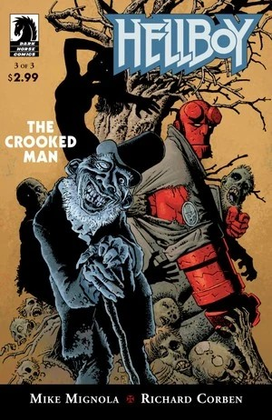
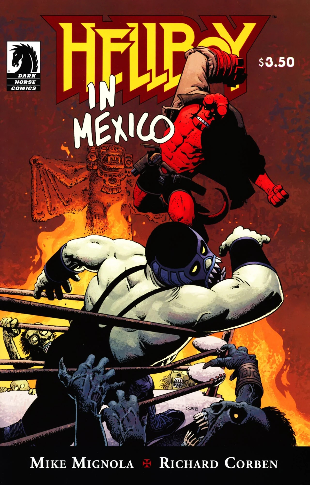
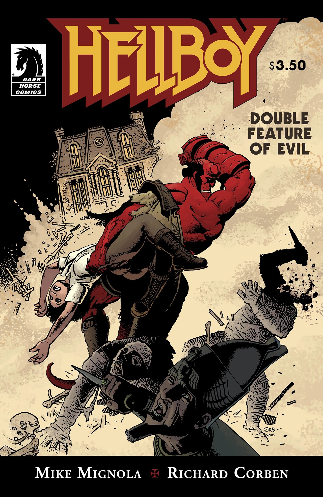
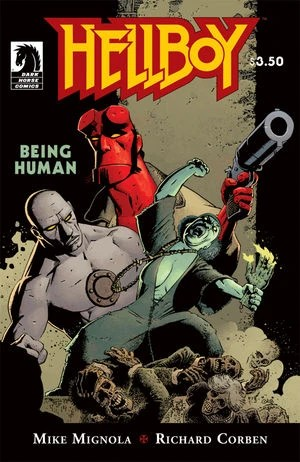

**Richard Corben** 是美国漫画画师，最广为人知的是他在《Heavy Metal》杂志上发表的插画奇幻故事。

## 内页画师

- [《地狱男爵：马科玛》（Hellboy: Makoma）](/entry/Makoma_%28story%29)
- [《地狱男爵：扭曲人》（Hellboy: The Crooked Man）](/entry/The_Crooked_Man_%28comic_story%29)
- [《地狱男爵：地狱新娘》（Hellboy: The Bride of Hell）](/entry/The_Bride_of_Hell)
- [《地狱男爵在墨西哥》（Hellboy in Mexico），又名《一场醉醺醺的模糊》（A Drunken Blur）](/entry/Hellboy_in_Mexico_%28story%29)
- [《地狱男爵：邪典双专场》（Hellboy: Double Feature of Evil）](/entry/Double_Feature_of_Evil)
- [《地狱男爵：生而为人》（Hellboy: Being Human）](/entry/Being_Human)
- [《地狱男爵：活死人之屋》（Hellboy: House of the Living Dead）](/entry/House_of_the_Living_Dead)
- [《地狱男爵：镜子》（Hellboy: The Mirror）](/entry/The_Mirror)

## 封面画师

## 外部链接

- [**Wikipedia：** Richard Corben](https://en.wikipedia.org/wiki/Richard_Corben)
- [**Comic Book DB：** Richard Corben](http://www.comicbookdb.com/creator.php?ID=684)
- [官方网站](http://www.corbenstudios.com)
- [The Most Complete Comicography of Richard Corben](http://www.muuta.net)

## 画廊

|Hellboy: Makoma #2

|Hellboy: The Crooked Man #1

|Hellboy: The Crooked Man #2

|Hellboy: The Crooked Man #3

|Hellboy in Mexico

|Hellboy: Double Feature of Evil

|Hellboy: Being Human
