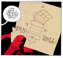

地狱男爵手臂的绘图，见于《[毁灭之右手](/entry/The_Right_Hand_of_Doom)》。

**毁灭之右手（Right Hand of Doom）**是[地狱男爵](/entry/Hellboy_%28character%29)出生后不久，由他的父亲[阿撒艾尔](/entry/Azzael)给他接上的一只石手。

## 概述

毁灭之右手由一截粗大的前臂和手掌组成，看起来像是用红色石头雕成。如今它已成为地狱男爵的替身右臂（因为阿撒艾尔在他还是婴儿时砍掉了他原本的右手，把这只石手移植了上去），这只手几乎刀枪不入、毫无痛觉，用来挥拳击打敌人时就像一把大锤。当然，毁灭之右手远比普通人的手（甚至比地狱男爵自己的左手）巨大，不太适合操作大多数物件，不过它已被证明灵巧到能徒手抓住一只苍蝇。地狱男爵靠他那只普通大小的左手操作武器和装置。正因如此，他很可能天生双手俱利。

毁灭之右手曾是[阿努姆](/entry/Anum)的右手——阿努姆是守望初生地球的"[伟大灵体](/entry/Watchers)"之一，正是用这只手创造了巨龙[奥古·桀哈](/entry/Ogdru_Jahad)。他又用同一只手束缚住巨龙，但随后其他灵体因他的所作所为反目相向，将他彻底毁灭——只留下他的右手，历史上包括第一代人类在内的诸多种族一直保存、守护着它。

作为创造并束缚奥古·桀哈的那只手，它也是"释放并号令"它们的钥匙；是一个终将引发世界末日的催化剂。

此外还有说法称，毁灭之右手的力量将会苏醒，赋予一支军队生命，那支军队将攻破地狱、天堂与人间之间的壁垒。

这只手臂甚至根本不必接在地狱男爵身上；即便脱离了他，它依然能完成自己的使命。不过也有人指出，如果这只手还接在地狱男爵身上时他就死了，手便会失去作用。因此他得出结论：防止它落入恶人之手的唯一办法，就是亲自保有并守护它。

## 其他媒体

### 真人电影

在[*《地狱男爵》（2004）*](/entry/Hellboy_%282004_film%29)中，拉斯普廷和豪普斯坦知道他的石质右手正是把[奥古·桀哈](/entry/Ogdru_Jahad)从沉睡中释放出来的钥匙。

## 注释与参考

<references />
