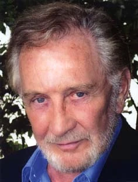

Roy Dotrice（1923-2017）是一位备受赞誉的演员，在《地狱男爵2：黄金军团》中饰演巴罗王（King Balor）。他出生于根西岛，曾在英国皇家空军服役，二战期间在德国战俘营中度过了近三年的战俘生涯。

这些小小的巧合，在为该角色选角时多少为他增添了几分优势。

  

## 其他知名角色

- 《伦敦的狄更斯》（*Dickens of London*）中的查尔斯·狄更斯
- 《短暂人生》（*Brief Lives*）中的约翰·奥布里

## 趣闻

- 他曾为多部小说录制过有声书改编版
- Roy Dotrice 的维基百科页面
