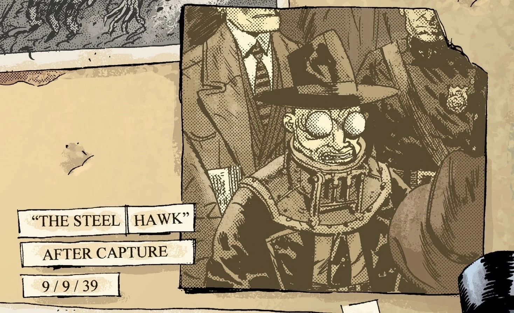
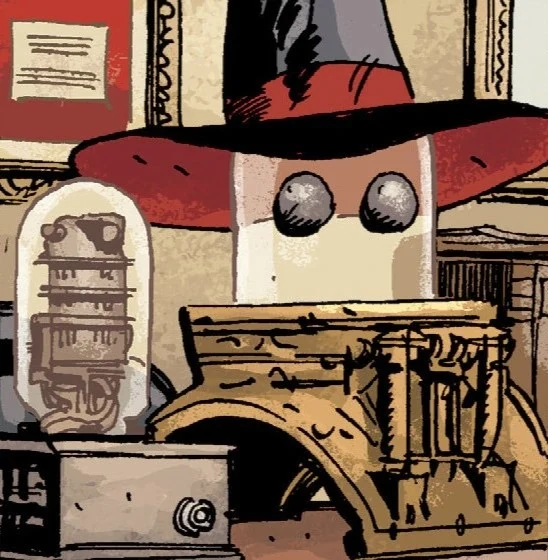
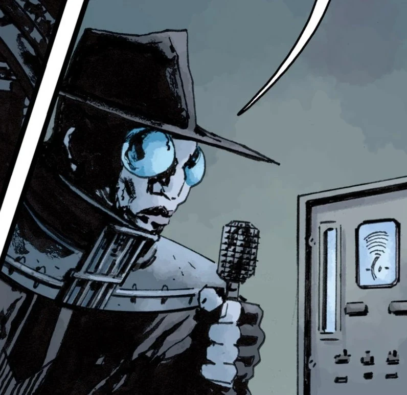
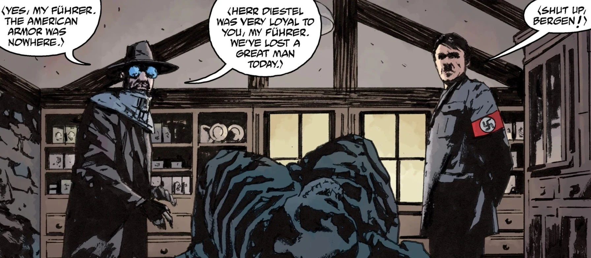
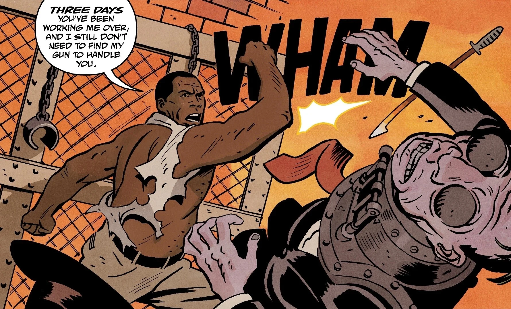

**鲁道夫·贝尔根（Rudolf Bergen）**，绰号**钢鹰（The Steel Hawk）**，是一名纳粹特工。除了知道他是纳粹分子之外，世人对他知之甚少。1936 年，他曾与[龙虾（The Lobster）](/entry/The_Lobster)及其搭档[哈里（Harry）](/entry/Harold_McTell)交手；1939 年他被盟军俘虏，但后来在 1944 年又被人看到与[雷蒙德·迪斯特尔（Raimund Diestel）](/entry/Raimund_Diestel)（第一代[黑焰](/entry/The_Black_Flame_(character))）合作，最终他的尸体被呈给[希特勒](/entry/Adolf_Hitler)。他的遗物最后落到了[兰迪斯·波普（Landis Pope）](/entry/Landis_Pope)的办公室里。

## 画廊

|

|

|

|

|
