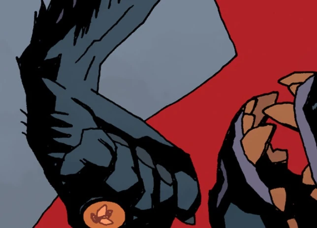

**卢迈尔（Rumael）**是地狱的一位[恶魔](/entry/Demon)领主（可能是侯爵或伯爵），统御着32个恶魔军团。他是在恶魔骚乱中丧生的众多恶魔之一，一同殒命的还有[亚斯她录](/entry/Astaroth)、[奥罗巴斯](/entry/Orobas)、苏列尔（Suriel）、[贝雷特](/entry/Beleth)、[沙克斯](/entry/Shax)、乌薛（Usiel）、拉乌姆（Raum）、塞米雅扎（Semyaza）、[摩洛克](/entry/Moloch)、彼列（Belial）、大衮（Dagon）以及[别西卜](/entry/Beelzebub)。

他死后，他麾下的一名骑士陷入抑郁，觉得自己的存在已毫无意义，便割断了自己的喉咙。

## 登场

- [《西班牙新娘》](/entry/The_Spanish_Bride)（尸体）
