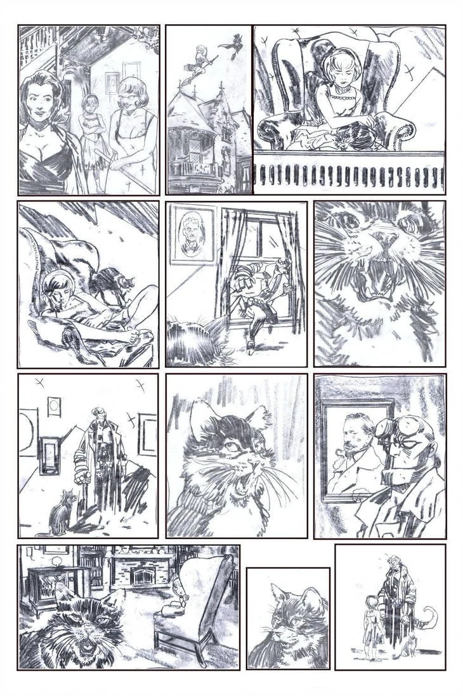
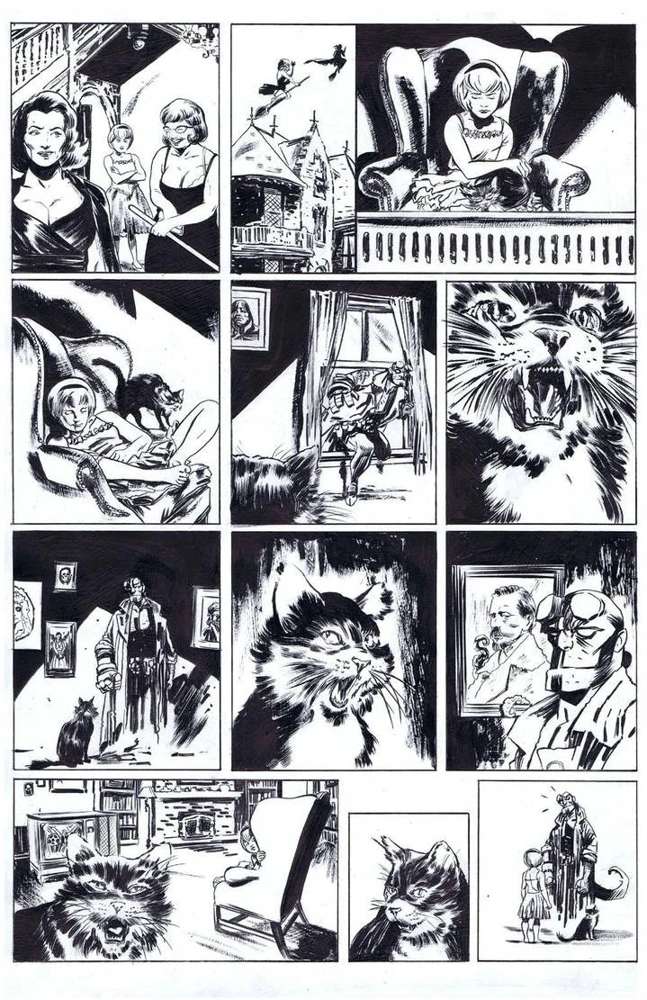
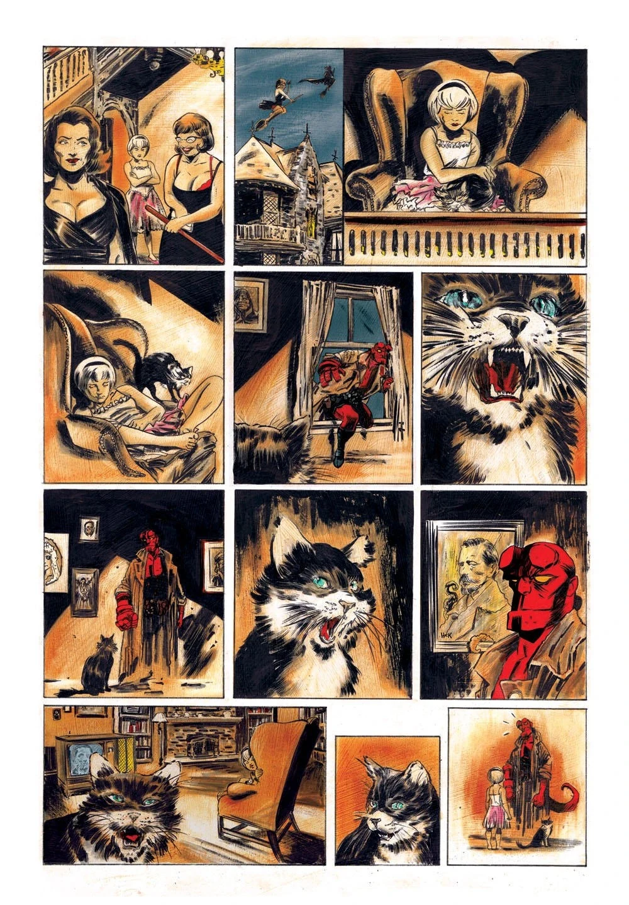

***《萨布丽娜遇见地狱男爵》（Sabrina Meets Hellboy）***是一个单页篇幅的非正史故事，与《萨布丽娜的惊心冒险》（Chilling Adventures of Sabrina）联动。它作为附赠故事刊载于《阿奇大战铁血战士》（Archie vs. Predator）\#1，由 Alex de Campi 编剧，Robert Hack 作画，[黑马漫画](/entry/Dark_Horse_Comics)出版。

## 剧情简介

八岁的萨布丽娜·斯佩尔曼（Sabrina Spellman）被留给她的使魔塞勒姆（Salem）照看。她看着电视睡着了。在她熟睡时，[地狱男爵](/entry/Hellboy_(character))正为[超自然调查防御署](/entry/B.P.R.D.)执行任务，他闯入斯佩尔曼家，要审问塞勒姆。两人的谈话吵醒了萨布丽娜。塞勒姆随即将“未来的女巫女王”介绍给“未来的[地狱](/entry/Hell)之王”。萨布丽娜向地狱男爵打招呼，问他愿不愿意和她一起“拼些乐高”。

## 内页画作

Robert Hack 已将他为这个故事创作的铅笔稿、墨线稿和上色稿分享到了自己的 DeviantArt 页面。

|铅笔稿

|墨线稿

|上色稿

## 外部链接

- DarkHorse.com 上的《阿奇大战铁血战士》#1 产品页
- DarkHorse.com 上的《阿奇大战铁血战士》精装合订本产品页
- Robert Hack DeviantArt 页面上的铅笔稿
- Robert Hack DeviantArt 页面上的墨线稿
- Robert Hack DeviantArt 页面上的上色稿
- 黑马数据库（Dark Horse Database）中的《阿奇大战铁血战士》#1 条目
