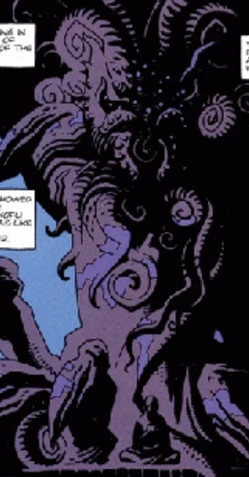
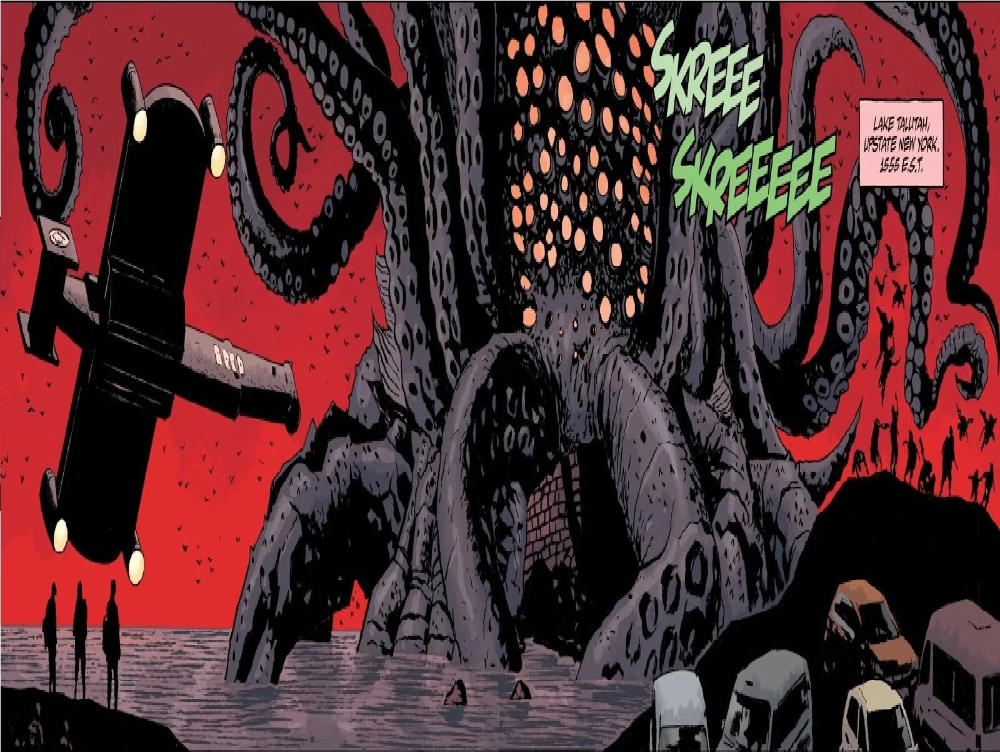

*萨杜-赫姆比他从前的状态好多了。从这里一直到北极圈，他饱餐了人类的血肉。他从这片湖水中吸食了生命。*

——拉斯普廷描述萨杜-赫姆。

**萨杜-赫姆（Sadu-Hem）**是 369 个[奥古·桀姆](/entry/Ogdru_Hem)之一，即[奥古·桀哈](/entry/Ogdru_Jahad)的子嗣。

## 历史

### 起源

萨杜-赫姆被[守望天使](/entry/Watchers)摧毁，随后在[极北族](/entry/Hyperboreans)的[戈里尼姆](/entry/Gorinium)陷落之时重生。

他被安置在戈里尼姆——北极圈之巅一座献给奥古·桀哈的神殿——以确保混乱七神在地球上始终保有一个立足点。

### 毁灭之种

第二次世界大战之后，为使奥古·桀哈"在他们被放逐的世界上永远保有一个立足点"，萨杜-赫姆被囚禁在地球上；[格里高利·拉斯普廷](/entry/Grigori_Rasputin)在北极圈之巅的[戈里尼姆](/entry/Gorinium)神殿中发现了萨杜-赫姆。拉斯普廷在雕像附近陷入出神状态，直到[特雷佛·布鲁姆](/entry/Trevor_Bruttenholm)教授和卡文迪什探险队到来。刚刚苏醒的拉斯普廷与萨杜-赫姆吞噬了布鲁姆探险队的大部分成员。布鲁姆在强烈的精神胁迫下被允许返回美国，拉斯普廷和萨杜-赫姆则盘踞在[卡文迪什庄园](/entry/Cavendish_Hall)地下。在外形上，萨杜-赫姆是一团可怖的触手与噼啪作响的螯爪，以一簇眼睛和触须充当头部。萨杜-赫姆本要充当拉斯普廷与奥古·桀哈之间的通道，但[亚伯·塞皮恩](/entry/Abe_Sapien)将拉斯普廷刺死、[丽兹·舍曼](/entry/Liz_Sherman)放火烧毁了整个地方，萨杜-赫姆随之被摧毁。

### 蛙群瘟疫

尽管萨杜-赫姆看似已被摧毁，十多年后，[B.P.R.D.](/entry/B.P.R.D.)局长[托马斯·曼宁](/entry/Thomas_Manning)在卡文迪什庄园废墟中发现了他的一小块残骸，并让人把这块真菌标本保存在新泽西的一间实验室里，直到萨杜-赫姆长得足够强壮，吸收了一个人形并逃脱。他逃到密歇根州的蟹角镇，

萨杜-赫姆把整座城镇的人都变成了凶残的[蛙怪](/entry/frog_monster)，并与奥古·桀哈的一名信徒结盟——拉斯普廷初次败北后，奥古·桀哈选此人为新的使者。当该局的部队赶到时，已经来不及拯救镇民，一场恶战随之展开，最后他再次被丽兹·舍曼焚毁。但在此之前，他新造出的大部分蛙怪已逃入美国乡野，引发了蛙群瘟疫危机。

### 你所熟知的魔鬼

主条目：[诸神黄昏](/entry/Ragna_Rok_%28story_arc%29)

格里高利·拉斯普廷借[瓦尔瓦拉](/entry/Varvara)之力复活后，复苏了所有在地球上被摧毁的奥古·桀姆，其中包括萨杜-赫姆。拉斯普廷向萨杜-赫姆和他所有的兄弟姊妹恳求：他们只需尽情欢庆胜利，因为他就是重返人间的巨龙，他们的胜利万无一失。萨杜-赫姆以一个前所未有的、远比过去强大的巨型形态归来，开始在昔日的纽约州境内横行肆虐。萨杜-赫姆率领一支由蛙怪和其他恐怖怪物组成的军队，追逐试图逃入地下洞穴的 B.P.R.D. 残部和人类幸存者。拉斯普廷败北、地狱男爵死去之后，萨杜-赫姆和他的兄弟姊妹们作为地球的新统治者耀武扬威地雄踞于大地之上。然而，奥西里斯俱乐部用地狱男爵被盗的手把奥古·桀哈的牢笼掷入地球，他随即丧命。爆炸摧毁了数个奥古·桀姆，此后不久，伊丽莎白·舍曼释放全部力量、带来诸神黄昏，净化了地球的剩余部分。萨杜-赫姆据推测与任何残存的奥古·桀姆一同被卷入这场烈焰，不过他（以及他兄弟姊妹们）的最终命运不得而知。

## 登场

一团可怖的触手与噼啪作响的螯爪，以一簇眼睛和触须充当头部。

在人形状态下，他是一个极度臃肿的人，头部因真菌而鼓胀，周围环绕着一圈眼睛，与他原本的形态相似。

## 能力与本领

- **生物操控**：奥古·桀姆能在细胞和基因层面扭曲血肉，把他人变成怪物。萨杜-赫姆尤其擅长用孢子感染人类，将其转化为蛙怪。
- **附身与吸收**：它能吸收一个宿主以获得新的实体形态，正如它对 B.P.R.D. 科学家埃德温·德比所做的那样。
- **精神胁迫**：萨杜-赫姆能对他人施加强大的精神控制，布鲁姆教授便是一例。
- **再生**：它可以在遭受看似致命的打击后留下自身一小块存活下来，供日后复苏。
- **超人体质**：它拥有庞大的体型、力量与耐久力，完全再生后尤其如此。
- **科技干扰**：它能干扰并破坏机器和电子设备。

## 武器

作为怪物般的存在，它自己的身体和能力——尤其是生物操控和纯粹的破坏力——就是它的武器。萨杜-赫姆长有螯爪和触手。

## 画廊

|Sadu-Hem was being Imprisoned while Rasputin remained in a trance near the statue until the arrival of Professor Trevor Bruttenholm and the Cavendish exploration party.

|Sadu-Hem in a colossal form and an army of frog-monsters to get vengeance on humanity in The Devil You Know:Ragna Rok
## 趣闻

灵感来自 H·P·洛夫克拉夫特笔下的[克苏鲁](https://lovecraft.fandom.com/wiki/Cthulhu)，尤其是这种生物头足类般的外形。

它也是 2004 年《地狱男爵》电影中巨兽的灵感来源。

## 链接

- [反派维基](https://villains.fandom.com/)中的[萨杜-赫姆](https://villains.fandom.com/wiki/Sadu-Hem)。
- [Dark Horse 数据库](https://darkhorse.fandom.com/)中的[萨杜-赫姆](https://darkhorse.fandom.com/wiki/Sadu-Hem)。
- [H·P·洛夫克拉夫特维基](https://lovecraft.fandom.com/)中的[萨杜-赫姆](https://lovecraft.fandom.com/wiki/Sadu-Hem)。
