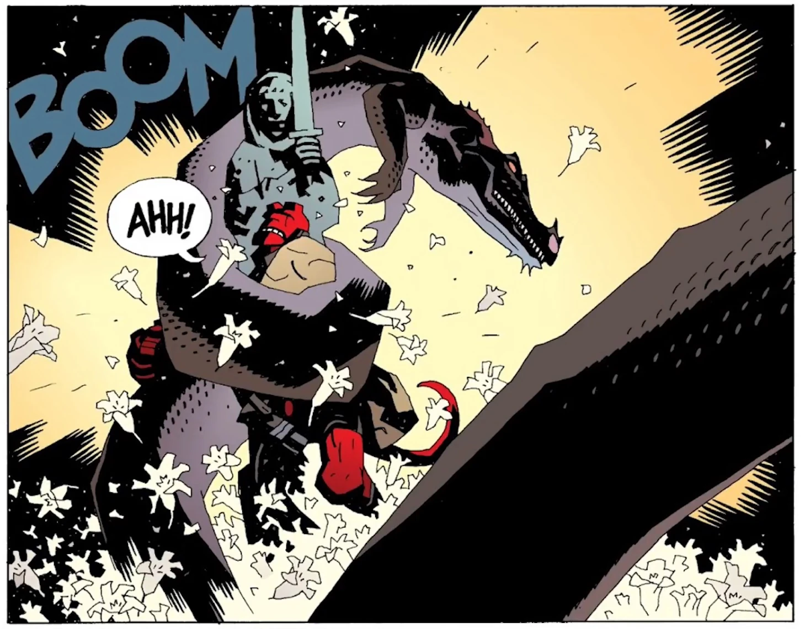

**圣伦纳德之龙**（Saint Leonard Wyrm）曾是一条栖息在英格兰的[龙](/entry/Dragons)。

## 概述

这条龙最初在 14 世纪被一名修士杀死，但到了 1956 年，这类生物再度出现，于是[奥西里斯俱乐部](/entry/Osiris_Club)向地狱男爵求助。

地狱男爵同意进入伦纳德的树林，走近一片立有那位修士雕像的空地。巨龙袭击了地狱男爵，把他紧紧缠压在雕像上。巨龙挤压着地狱男爵和雕像。雕像的顶部断裂，石剑坠落，杀死了巨龙。

## 趣闻

- 其灵感可能来自塔策尔蠕虫（Tatzelwurm）的传说。

## 登场

- *[《野兽本性》](/entry/The_Nature_of_the_Beast)*
