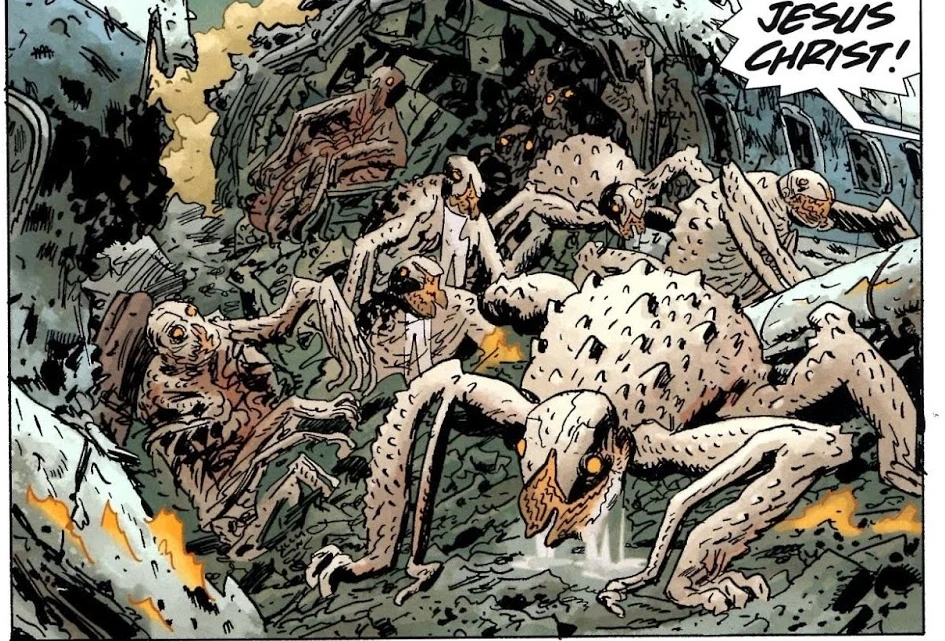

**索尔顿湖怪物（Salton Sea Monster）**是[奥格德鲁·赫姆](/entry/Ogdru_Hem)之一，即[奥古·桀哈](/entry/Ogdru_Jahad)的子嗣。

## 概述

在[《恐惧之王》](/entry/King_of_Fear_(story))中，[伊丽莎白·舍曼](/entry/Elizabeth_Sherman)摧毁了[黑焰](/entry/The_Black_Flame_(character))的军队之后，这头生物从海洋中爬出。

起初，这个存在被视为末日的先兆，但很快就被许多人类当作神祇来崇拜。核心信徒之一是来自亚特兰大的前基督教牧师 [Paul Nedin](/entry/Paul_Nedin)，他创立了“活的地球教会”。

与大多数奥格德鲁·赫姆一样，这头生物也会释放一种气体，能把人类变成怪物。

最近它开始活动并产卵。

## 画廊

## 登场

- [*《B.P.R.D.：恐惧之王》*](/entry/King_of_Fear_(story))
- [*《B.P.R.D.：人间地狱——新世界》*](/entry/New_World_(B.P.R.D._story_arc))
