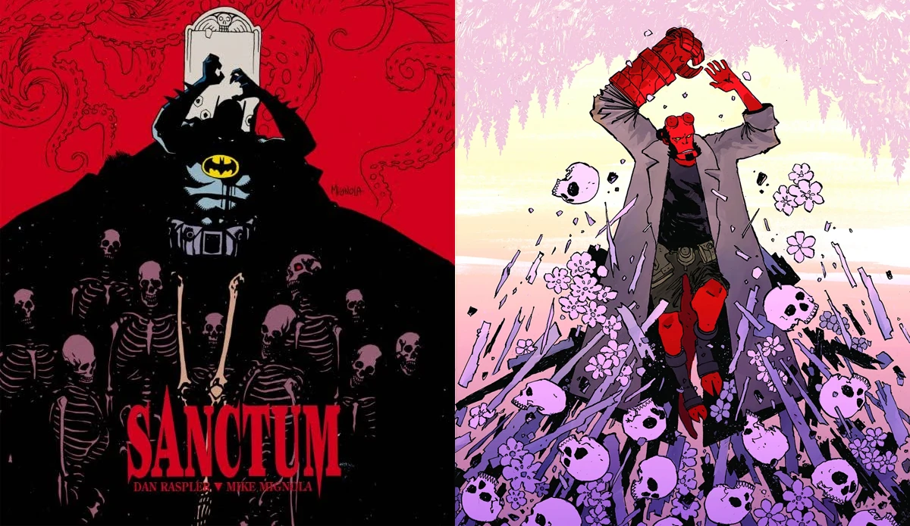

*《土星回归》（Saturn Returns）*是 *《地狱男爵与超自然调查防御署》*的一个三期故事弧，由 [迈克·米格诺拉](/entry/Mike_Mignola) 与[斯科特·阿利](/entry/Scott_Allie)编剧，[Christopher Mitten](/entry/Christopher_Mitten) 作画。本故事弧是上色师 [Brennan Wagner](/entry/Brennan_Wagner) 的首次亮相。故事设定在 1975 年 10 月。

## 剧情简介

### 第一部分

新罕布什尔州一座一直为失踪事件所困扰的小镇，因一名当地人发现了一堆可追溯至数十年前的尸体而陷入震动；地狱男爵与超自然调查防御署的金斯利探员（Agent Kinsley）抵达现场，却被围绕这些仪式化杀戮的种种超自然推测弄得应接不暇。

### 第二部分

地狱男爵与金斯利探员更深入地探究新罕布什尔树林中发现的一批尸体背后的谜团。可能的解释包括狼人、吸血鬼和恶魔……但真相或许更加离奇！与此同时，离家出走的丽兹·舍曼发现，街头生活要付出沉重的代价！

### 第三部分

种种推测与线索都陷入僵局，但这座惊恐的新罕布什尔小镇里尸体仍在不断堆积。在怪物被控制住之前，还要有多少人送命？金斯利探员与当地警方必须争分夺秒，在没有地狱男爵的情况下阻止这个嗜血的窃尸者——地狱男爵因紧急事务被派往了别处。

## 画廊

全部封面由 [Christopher Mitten](/entry/Christopher_Mitten) 绘制。

第 \#1 期

第 \#2 期

第 \#3 期

## 趣闻

- 《土星回归》第 \#3 期的封面，是迈克·米格诺拉为《蝙蝠侠：黑暗骑士传说——圣所》（Batman: Legends of the Dark Knight—Sanctum）绘制的封面的反转版本。

地狱男爵与超自然调查防御署出版顺序

&#10;
前作
瓦尔古的野兽
《土星回归》

后作
戈洛斯基车站的漫漫长夜
