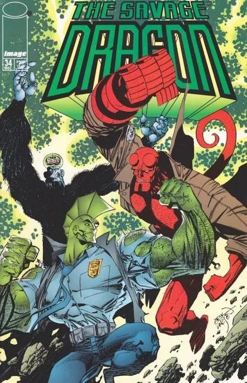

*关于平装合订本，见[《野蛮龙／地狱男爵》(合订本)](/entry/Savage_Dragon_Hellboy_(TPB))。*

《野蛮龙／地狱男爵》(Savage Dragon/Hellboy)是 Image Comics 于 2002 年出版的一部两期限定联动漫画，收录了最初于 1996 年 12 月出版的《野蛮龙》(The Savage Dragon)第 \#34、\#35 期。这次联动是 Savage Dragon 创作者 Erik Larsen 与地狱男爵创作者 Mike Mignola 的合作，让 Image Comics 那位绿皮肤警察与黑马漫画的超自然调查员聚到了一起。

## 剧情简介

故事开始时，犯罪组织"邪恶圈"(Vicious Circle)的首领 CyberFace 在经由"重生计划"(Project: Born Again)复活后身体开始腐烂。为了救他，Abner Cadaver 施法将全球各地的不死生物召唤到芝加哥，这引起了地狱男爵的注意，他前来调查这起超自然骚乱。与此同时，BrainiApe——其真实身份是被保存下来的阿道夫·希特勒的大脑，被装进了大猩猩的身体——奉 CyberFace 之命前去除掉 Dragon。

这部联动采用了经典的超级英雄组队模式：两位主角最初发生冲突，随后联手对抗共同的敌人。BrainiApe 用他的精神控制能力操纵两位英雄，迫使他们互相搏斗，直到他们摆脱他的影响、合力击败这个反派及其不死生物大军。

### 第一部分：*Das Kann Nicht Sein（这不可能）*

故事在两个时间线中展开。在一段设定于 1952 年 11 月 3 日的闪回中，超自然调查员地狱男爵被派往罗马尼亚，对抗死灰复燃的纳粹党。与普遍的看法相反，阿道夫·希特勒在第二次世界大战中幸存下来，他身穿战斗装甲与地狱男爵正面对峙，但装甲的胸部开始危险地发光。地狱男爵在一场大爆炸发生之前脱身，希特勒的头颅则被 Baron Blitzkrieg 回收，后者希望至少保住这个独裁者的大脑。

设定于 1996 年 12 月 21 日的当代故事线揭示，希特勒的大脑被保存在一只大猩猩的体内，由此造就了反派 BrainiApe。BrainiApe 在邪恶圈的新总部醒来，奉 CyberFace 之命前去刺杀 Dragon。与此同时，身体不断腐烂的 CyberFace 找来 Abner Cadaver 召唤不死生物，这些生物随即袭击了地狱男爵。

### 第二部分：*地狱男爵！我现在想起来了——*

故事围绕 BrainiApe 展开——这个反派裸露的大脑长在猿类身躯之上，他在遭遇地狱男爵后恢复了被压制的记忆，意识到自己实际上就是阿道夫·希特勒被保存下来的大脑。叙述揭示：1952 年，地狱男爵曾在罗马尼亚与希特勒对峙，引发的爆炸摧毁了这个独裁者的身体，而他的大脑被效忠的纳粹科学家抢救出来。经过放射与化学处理，这颗大脑最终被接到一只猿类的身体上，造就了名为 BrainiApe 的怪物。

BrainiApe 运用心灵感应能力强迫 Dragon 与地狱男爵互相搏斗，Dragon 在体能上胜过了这位超自然调查员。随后，反派召唤出一头巨大的海怪，将两位英雄吞下。然而，地狱男爵的政府盟友出手杀死了海怪，两位英雄得以从它的体内逃脱。最终，Dragon 用一把刀刺穿了 BrainiApe 裸露的大脑，对决就此结束，这个反派加诸地狱男爵的精神控制也随之解除。

## 附加内容

该平装合订本还收录了三页由[迈克·米格诺拉](/entry/Mike_Mignola)与 Jae Lee 创作的封面与插画画廊。

## 画廊

*《野蛮龙》第 1 辑 \#34：  
Das Kann Nicht Sein（这不可能）*

*《野蛮龙》第 1 辑 \#35：  
地狱男爵！我现在想起来了——*

*《野蛮龙／地狱男爵》*合订本

|Savage Dragon Vol 1 #34: Das Kann Nicht Sein (This Cannot Be)
