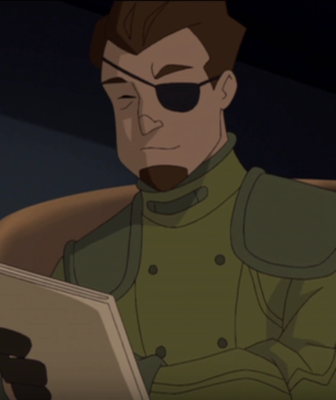

**斯科特·克拉克（Scott Clark）** 是[超自然调查防御署（B.P.R.D.）](/entry/Bureau_for_Paranormal_Research_and_Defense)的一名外勤探员，曾参与搜寻 [弗拉基米尔·朱雷斯库](/entry/Vladimir_Giurescu) 的城堡。

## 历史

克拉克与探员同僚[亚伯·塞皮恩](/entry/Abraham_Sapien)一起被派去搜寻弗拉基米尔·朱雷斯库的城堡。搜寻结束后，克拉克和亚伯试图找到失踪的[地狱男爵](/entry/Hellboy_%28character%29)。两人追踪他到罗马尼亚的一座教堂，却只发现了地狱男爵腰带的信号器，以及 Nicholas Bundez 神父的头颅。意识到中计后，他们脚下的教堂地板塌陷，克拉克被下方的一根尖刺刺穿。这是[格里高利·拉斯普廷](/entry/Grigori_Rasputin)为亚伯设下的陷阱。

## 趣闻

- 克拉克的外貌与漫威漫画的著名角色[尼克·弗瑞](/entry/w%3Ac%3Amarvel%3ANicholas_Fury_%28Earth-616%29)极为相似。他还被画成使用喷气背包的样子，而弗瑞也曾无数次这样做。这很可能是[迈克·米格诺拉](/entry/Mike_Mignola)有意安排的致敬。

## 其他媒体

 克拉克在直接发行 DVD 的[动画](/entry/Hellboy_Animated)电影《[地狱男爵：铁血惊魂](/entry/Hellboy%3A_Blood_and_Iron)》中作为小角色登场。与漫画相比，他的形象略有改动，多了一撮山羊胡。

克拉克由一位未署名的演员配音。
