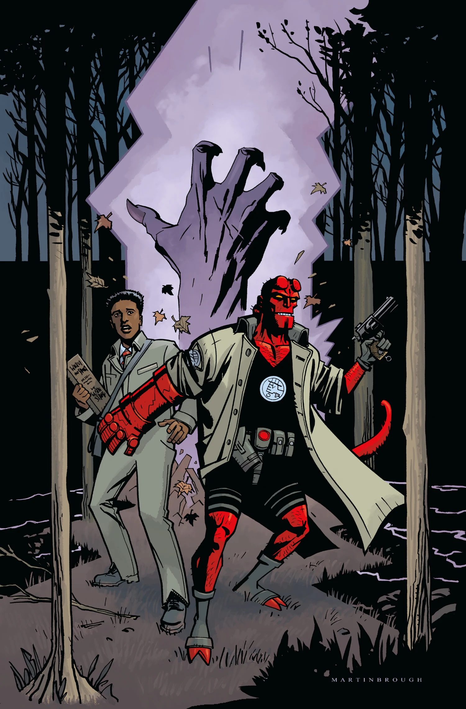

***Secret Nature*** 是 *[Hellboy and the B.P.R.D.](/entry/Hellboy_and_the_B.P.R.D.): 1955* 中一期完结的故事弧，由 Mike Mignola 与 Chris Roberson 编剧，Shawn Martinbrough 作画。

## 剧情梗概

俄勒冈州偏远林区有一群少年失踪，[地狱男爵](/entry/Hellboy_%28character%29) 和 [伍德罗·法瑞尔](/entry/Woodrow_Farrier) 循线追查，却不得不直面一个神秘动物学意义上的恐怖存在——而它的起源竟与地狱男爵自己颇为相似！

## 画廊

封面作者 [Shawn Martinbrough](/entry/Shawn_Martinbrough)。

|*Secret Nature*
