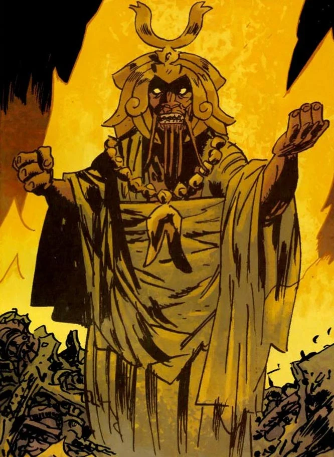

**左手仆从**(Servants of the Left Hand)是一个生活在地下的类人生物种族。

## 起源

左手仆从是在培养槽中培育出来的，生来便是左手之民的奴隶种族。它们的主人是[极北族人](/entry/Hyperboreans)(Hyperboreans)的后裔——这些极北族人在极北帝国覆灭后退入地下。因为崇拜黑色女神[赫卡特](/entry/Hecate)，他们自称左手之民。

仆从们最终奋起反抗，杀死了主人。此后他们开始追随[恐惧之王](/entry/King_of_Fear_(character))(King of Fear)，奉其为新的领袖。恐惧之王打算修复左手之民建造的战争机器，并为它们寻找动力来源。一旦大功告成，恐惧之王希望为他的子民征服地表世界，毁灭人类。

## [空心地球](/entry/Hollow_Earth)

[超自然调查防御署](/entry/Bureau_for_Paranormal_Research_and_Defense)最早遭遇这些生物，是在它们掳走了调查局特工丽兹·舍曼的灵魂之后。丽兹在雅戈泰(Agartha)的修道院中修炼时遭到这些生物的袭击，灵魂被窃，只留下失去生气的躯体。调查局特工[亚伯·塞皮恩](/entry/Abe_Sapien)、人造人[罗杰](/entry/Roger)以及新成员[约翰·克劳斯](/entry/Johann_Kraus)循迹追入地下。仆从们正用丽兹的灵魂为它们古老的机器与武器供能。然而，亚伯成功打断了这一过程，开枪击中恐惧之王，趁仆从们分神之际，罗杰摧毁了机器，救出了丽兹的灵魂。受伤的恐惧之王连同他的数台战争机器一起坠入了更深的地底。

## 结盟

后来，左手仆从与[青蛙怪物](/entry/Frog_monster)及其首领[黑焰](/entry/The_Black_Flame_(character))结成了同盟。然而这一同盟并不稳固，尤其是恐惧之王心存顾虑——他认为自己的权力正遭到黑焰的篡夺。

## 外形与特征

左手仆从是矮壮的类人生物，体色呈暗淡的红橙色。调查局特工亚伯·塞皮恩初次遭遇它们时，曾把它们称作"鼹鼠人"。它们野蛮嗜血，但也能表现出相当的智慧，并且掌握着修复与维护极北族古老战争机器的知识。

仆从们死后，其灵魂也有一些值得注意的特性。在《巫师猎人》(Witchfinder)故事*[《为天使效力》](/entry/In_the_Service_of_Angels)*中，爱德华·格雷爵士遭遇了一个左手仆从的鬼魂，它正在维多利亚时代的伦敦作祟。这个鬼魂表现出吸血鬼般的特征，靠吸食受害者的鲜血来增长体型与力量。它可以选择呈现实体或虚体形态，还能改变外貌，让自己看起来更像人或更像怪物。然而，一旦与自己的骸骨重聚，这个生物便复活了，爱德华爵士得以开枪将它击杀。
