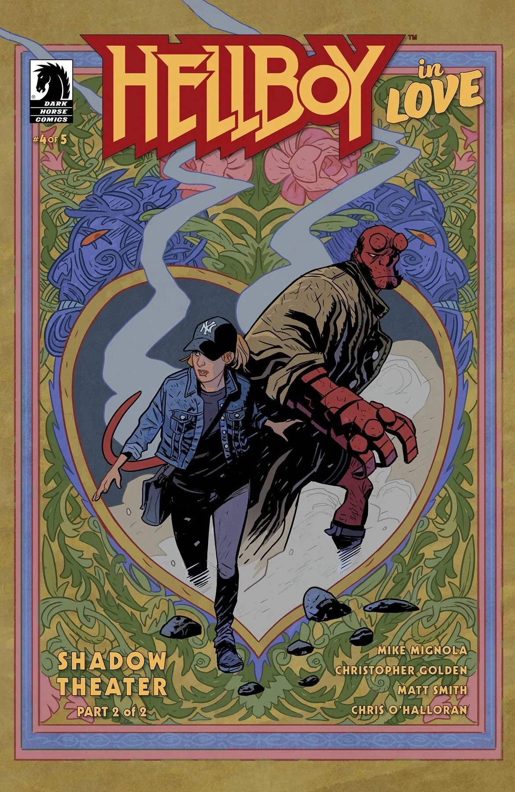

***《影子剧场》***是《地狱男爵恋爱中》(*Hellboy in Love*) 的一个两期故事弧，由 Mike Mignola 与 Christopher Golden 编剧，Matt Smith 绘制。

## 剧情简介

### 第一部分

地狱男爵与阿纳斯塔西娅意外前往土耳其，一路上火花四溅。阿纳斯塔西娅昔日的教授发掘出了土耳其皮影戏的发源地，但潜伏在影子里的东西似乎远比他预想的要多。面对恶魔的存在对地狱男爵来说本是家常便饭，但与阿纳斯塔西娅并肩作战却是一个全新的挑战！

### 第二部分

地狱男爵与阿纳斯塔西娅对土耳其皮影戏历史的了解，超出了他们的预期。在与木偶戏角色卡拉格兹（Karagöz）和哈吉瓦特（Hacivat）的邪恶影子交手之后，两人很快发现，要应付的远不止皮影偶！但任何可能的出路，都必须先通向影子更深处……

## 画廊

全部封面由 Matt Smith 绘制。

*《地狱男爵恋爱中》* \#3
*《影子剧场》*（第一部分）

*《地狱男爵恋爱中》* \#4
*《影子剧场》*（第二部分）

|Hellboy in Love #4 Shadow Theater (Part 2)
