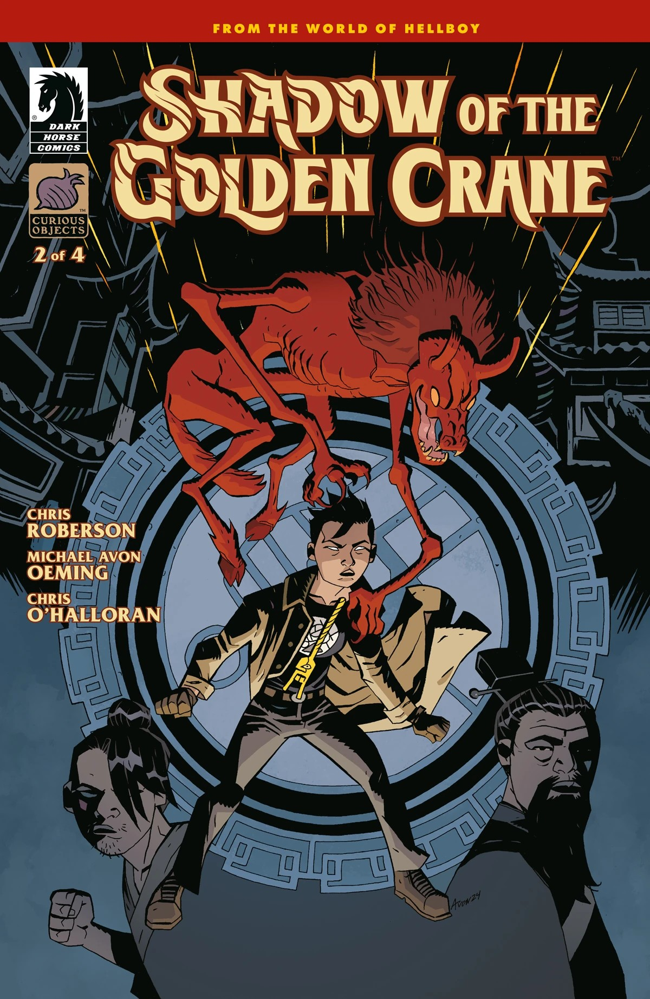
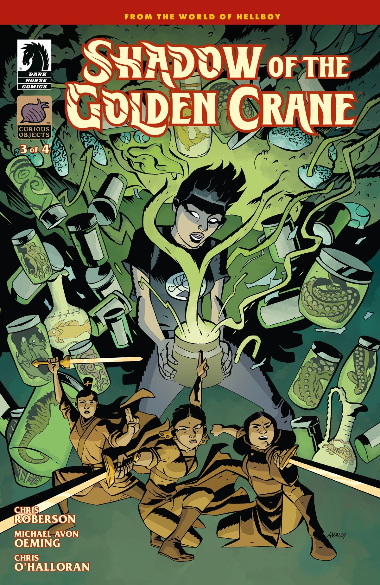
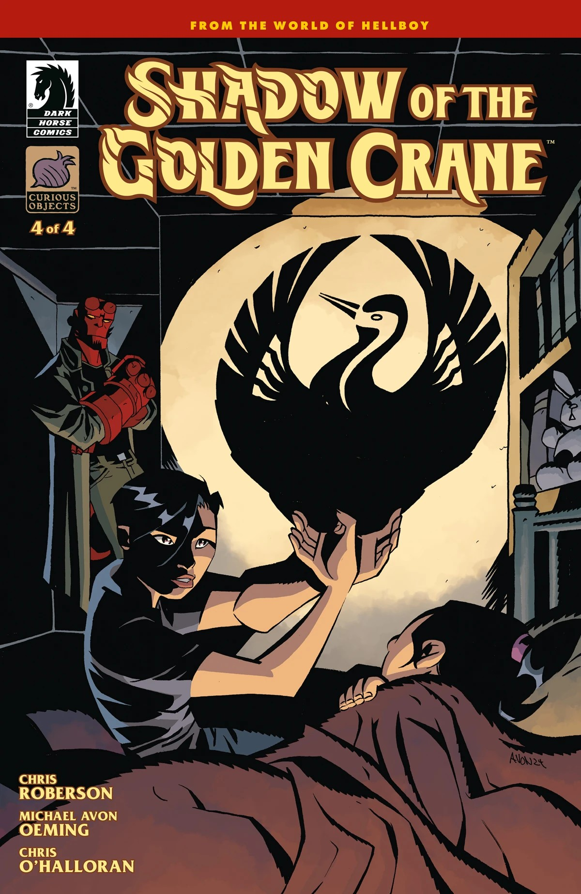

*本条目是一篇小作品。你可以帮助地狱男爵维基扩充它。*

***《金鹤之影》***是一部四期限定连载，由克里斯·罗伯森（Chris Roberson）编剧，Michael Avon Oeming 绘制。

## 出版历史

该系列在编写时力求让每一期既可以作为独立故事阅读，又是一个更宏大整体的组成部分。

## 剧情简介

### 第一部分

20世纪60年代，超自然调查防御署的一桩神秘案件迫使探员[苏珊·项](/entry/Susan_Xiang)深入探究行事隐秘的[金鹤会](/entry/Golden_Crane_Society)的历史，同时也牵出了她自己家族往事中的种种疑问。

### 第二部分

一名被附身的女子与一个飞车党之间的关联，其根源可追溯到蒙古地区数百年来一个截然不同的帮派。

### 第三部分

项探员在一家草药店调查闹鬼事件，却被卷入一张古老巫术的大网。

### 第四部分

一把被恶魔附身的匕首让项探员与地狱男爵、克斯特勒（Koestler）探员联手，必须在这些古老的黑暗势力感染更多、更多事物之前将其阻止。

## 画廊

封面作者 Michael Avon Oeming

第 \#1 期

第 \#2 期

第 \#3 期

第 \#4 期

|第 #2 期

|第 #3 期

|第 #4 期
