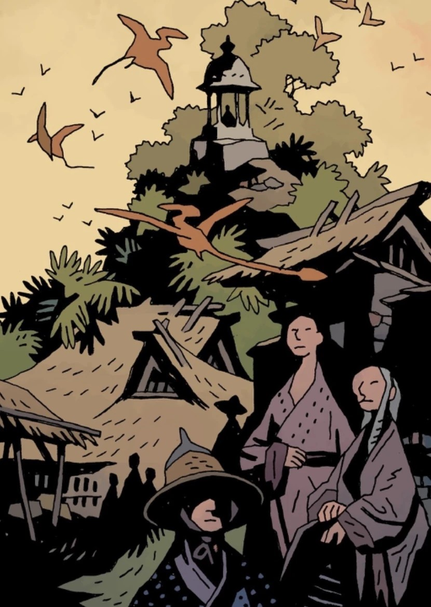

**香巴拉（Shambhala）**，又称 **圣海伯鲁姆（Sancti Hyperberum）**和 **圣阿布-朱拉（Sancti Ab-Jura）**，是一片地下之地。那里栖息着翼龙等古老爬行动物。

## 历史

### 起源

香巴拉由[海伯利亚人](/entry/Hyperboreans)在其帝国覆灭之后建立，被描述为一座新的伊甸园。他们培育了一个新的[奴隶种族](/entry/Servants_of_the_Left_Hand)，但这个种族最终起义反叛，杀死了所有主人，转而追随[恐惧之王](/entry/King_of_Fear_(character))。

这座乐园实际上是由 Frankenstein's Monster 建立的：他击败了奥格德鲁·赫姆之一的[约塔-赫姆](/entry/Yotha-Hem)（Yotha-Hem），当时有一位[维利](/entry/Vril)（Vril）少女相助。维利的能量孕育出一片郁郁葱葱的雨林。Frankenstein's Monster 此后便生活在这座新乐园中。

### 拉格纳·洛克

随着[拉格纳·洛克](/entry/Ragna_Rok_(event))临近，爱德华·格雷爵士向[地狱男爵](/entry/Hellboy_(character))解释说，人类必须转入地下才能存活，并提供了若干个可供他们下行进入的坐标。地狱男爵把这一情报交给了[超自然调查防御署](/entry/Bureau_for_Paranormal_Research_and_Defense)的成员，后者又将其转发给世界各地仍在运作的新闻电视台。

世界各地的人们开始向地下转移，其中包括超自然调查防御署的残余人员；他们成功下到地下，但在此过程中有许多成员——例如 James Henry O'Donnell、[Stazz](/entry/Nastassja_Hansen) 和 [泰德·霍华德](/entry/Ted_Howards)——丧生于[奥格德鲁·赫姆](/entry/Ogdru_Hem)之手。幸存者抵达了这片新土地，那是一片郁郁葱葱的雨林，栖息着史前野生动物。

随着地表世界被毁、并为新一代人类做好准备，人类将在地下开辟出新的未来。

## 画廊

人类的未来在地下

|Humanity's  future is underground
## 居民

- [菲尼克斯·埃斯佩霍](/entry/Fenix_Espejo)
- Frankenstein's Monster
- Connor Giarocco
- [翼龙](/entry/Pterosaur)

## 登场

- [《侍奉天使》](/entry/In_the_Service_of_Angels)
- [《弗兰肯斯坦：地下》](/entry/Frankenstein_Underground)
- [《拉格纳·洛克》](/entry/Ragna_Rok_(story_arc))
