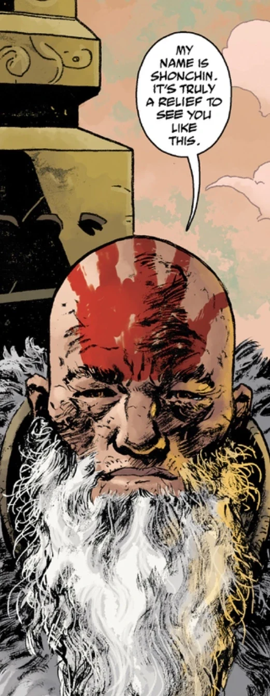

**雄钦（Shonchin）**是一位来自[极北族人](/entry/Hyperboreans)时代的古老 T'shethuan 萨满，一直存活到了 21 世纪。

## 历史

### [《恐惧之王》](/entry/King_of_Fear_%28story%29)

一位神秘萨满出现在[丽兹·舍曼](/entry/Elizabeth_Sherman)预见的未来幻象中。他指向[地狱男爵](/entry/Hellboy)的幻象，后者鼓励丽兹释放力量对抗[奥格德鲁·赫姆](/entry/Ogdru_Hem)。就在丽兹即将用自己的力量重创[黑焰](/entry/The_Black_Flame_%28character%29)及其盟军时，萨满将[亚伯·塞皮恩](/entry/Abe_Sapien)和其余[超自然调查防御署（B.P.R.D.）](/entry/Bureau_for_Paranormal_Research_and_Defense)探员传送到了安全之处。

### [《末日》](/entry/End_of_Days)

黑焰以心灵感应嘲讽[潘雅](/entry/Panya_%28character%29)世界末日将至之后，一个神秘的萨满幻影回应了潘雅的祈祷。他借潘雅之口说话，潘雅又借昏迷中的[菲尼克斯·埃斯佩霍](/entry/Fenix_Espejo)之口诵出一段祷文，这段祷文能够耗尽黑焰的力量，为[约翰·克劳斯](/entry/Johann_Kraus)和丽兹争取一战之机。

### [《Suwanee 上空的阴影》](/entry/The_Shadow_Over_Suwanee)

萨满再次现身于[古斯塔夫·施特罗布尔](/entry/Gustav_Strobl)面前，警告他：若他在追查亚伯·塞皮恩真实起源的过程中横加干涉，必将承担后果。

### [《黑暗可怖的深渊》](/entry/Dark_and_Terrible_Deep)

萨满在一座水下神庙中出现在亚伯面前——[Langdon Everett Caul](/entry/Langdon_Everett_Caul)正是在那里发现了装有那个[存在](/entry/Water_Spirit)的卵，而那个存在将他转化。这个男人自报身份：他叫雄钦，是一名萨满，曾是极北族人的信徒；当右手之道的追随者们升上星空时，他被留了下来。他向亚伯讲述了自己数千年前的往事。雄钦和他的同伴试图劝说一座堕入[黑色女神](/entry/Hecate)影响之下的城市回头。他们低估了腐化的程度，被擒获。城中的人拷打他们，直到他们背弃信仰、宣誓效忠黑色女神。雄钦最先崩溃，成了左手之道的追随者。他被释放，获准逃走。然而他的朋友拒绝屈服，他的信念坚不可摧，竟孕育出一头奇迹般的生物，将周围的村民与土地一并湮灭。

由于自己的软弱，雄钦被留在尘世，而他的同族都升上了 Hyperberum。他成了一个崩溃的废人，无法召唤维利之力。但他体内仍残存着足够的维利，使他无法死去。他向亚伯揭示了真相：亚伯并非奥古·桀哈的使者，而实为旧世界之光，将把这光带入下一个世界。他鼓励亚伯不要再逃避，终于去拥抱自己的命运。

## 能力

雄钦曾是右手之道的信徒，能够运用维利之力。据雄钦自己所说，堕入黑暗后他便无法再召唤这种力量，但体内仍保留着足以让他存活数千年的维利。在登场的各期中，雄钦似乎已经恢复了足够的力量，得以在幕后行动，拖延天启的到来。
