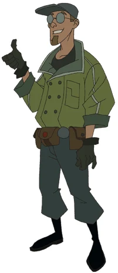

**西德尼·利奇（Sidney Leach）**是 [B.P.R.D.](/entry/Bureau_for_Paranormal_Research_and_Defense) 的外勤探员，拥有探测和操纵金属的能力。

## 历史

### [唤醒恶魔](/entry/Wake_the_Devil)

利奇在 B.P.R.D. 的第一次任务中，与同袍探员[丽兹·舍曼](/entry/Liz_Sherman)和[巴德·沃勒](/entry/Bud_Waller)一起被派往罗马尼亚，搜寻[弗拉基米尔·朱雷斯库](/entry/Vladimir_Giurescu)那座神秘的城堡。任务期间，利奇发现舍曼拥有念力纵火（pyrokenisis）的能力，即凭意念生火。三人最终在一个炼金术士的实验室里发现了一具死去的生物，沃勒说那是一个[何蒙库鲁兹](/entry/Homunculus)——用血和粪便做成的人造人形生物，或称“中世纪试管婴儿”。然而，何蒙库鲁兹吸走了丽兹的念力火焰能量，活了过来。利奇的双手被严重烧伤，沃勒不得不开枪击中舍曼的手臂，以切断能量的流动。那生物随即扭断了沃勒的脖子将他杀死，然后逃走。

### [近乎巨人](/entry/Almost_Colossus)

八天后，利奇与[汤姆·曼宁](/entry/Tom_Manning)、[亚伯·塞皮恩](/entry/Abraham_Sapien)以及奥拉兹博士一起出现在特尔戈维什泰的瓦乌尔研究所，丽兹因失去念力纵火能力正在那里接受治疗。在那里，利奇向奥拉兹讲述了事情的经过——他的双手是如何被烧伤的，以及那个何蒙库鲁兹的事。几天后，舍曼因失去能力而死去。然而片刻之后，[地狱男爵](/entry/Hellboy_%28character%29)和那个何蒙库鲁兹走进了医院——地狱男爵给他起了个绰号叫“[罗杰](/entry/Roger)”（这让利奇颇为困惑）。接着，罗杰把丽兹的念力纵火之力导回她体内，使她死而复生，代价却是他自己的生命。 此后不久，西德尼可能从 B.P.R.D. 退役了。他目前下落不明。

## 能力与本领

西德尼能够从很远的距离外探测金属，并对其加以操纵。

西德尼工作时非常随性（比如把奥拉兹博士称作“O 博士”，自称人体金属探测器）。

## 动画版

西德尼·利奇在动画版[《地狱男爵：铁血惊魂》](/entry/Hellboy__Blood_and_Iron)中登场，名字拼作“Sydney Leach”（而非 Sidney）。利奇由罗伯·鲍森配音。

## 另见

- [丽兹·舍曼](/entry/Liz_Sherman)
- [巴德·沃勒](/entry/Bud_Waller)
- [罗杰](/entry/Roger)
- [唤醒恶魔](/entry/Wake_the_Devil)
- [近乎巨人](/entry/Almost_Colossus)
- [亚伯·塞皮恩](/entry/Abe_Sapien)
- [汤姆·曼宁](/entry/Tom_Manning)
- 奥拉兹博士
- [地狱男爵](/entry/Hellboy_%28character%29)
