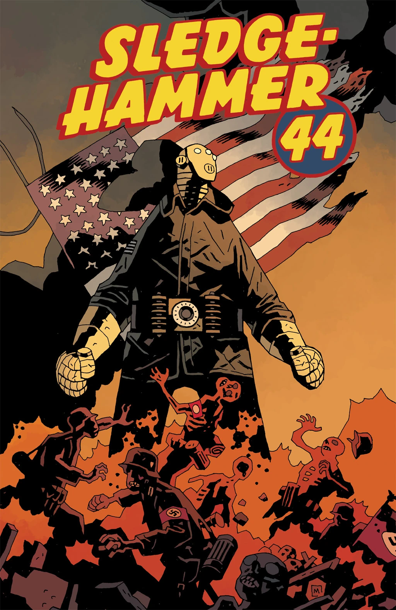
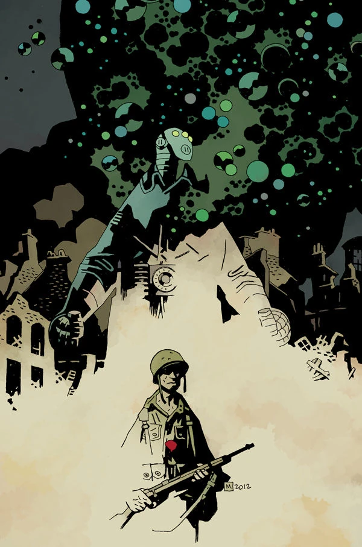

《**Sledgehammer 44**》（Sledgehammer 44）是一部两期迷你系列，于2013年3月出版，画作由 Jason Latour 创作。故事设定在1944年，虽然属于地狱男爵宇宙，但并不隶属任何已确立的系列。在当时，[这是此类作品中的第一部](/entry/The_Hellboy_Universe_Comics)。

[John Severin](/entry/John_Severin) 原本是该书的画师。在他去世后，[Jason Latour](/entry/Jason_Latour) 接替了绘画工作。Severin 为该书创作的部分画作刊登在 [Hellmail](/entry/Hellmail) 以及《Sledghammer 44》平装合集中，同时还附有 [Scott Allie](/entry/Scott_Allie) 撰写的献词。

一张出自 [Hellmail](/entry/Hellmail) 的 John Severin 版《Sledgehammer 44》画作掠影。

## 剧情简介

### 第一部

1944年8月：一个身穿[钢铁护甲](/entry/Vril_Energy_Suit)的男人从一架美国战机上降落到法国战场，他试图在那里杀出一条血路，穿过纳粹军队以及他们藏在军火库中加以保护的巨型战争机器。

### 第二部

面对纳粹军队在火力和人数上的双重压制，一队美军士兵必须团结起来，释放铁甲神秘男子体内的海伯波里安力量，才能平安回家。

## 画廊

