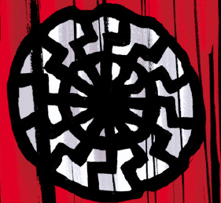

Sonnenrad_Society.png

**太阳轮学会（Sonnenrad Society）**（又称**黑太阳教团（Order of the Black Sun）**）是纳粹德国的秘术局之一。

## 背景

太阳轮学会创立于第三帝国最初的岁月里。学会的任务是调查一切与秘术力量有关的事物，包括搜寻被岁月黄沙掩埋、或深藏于地底的过往文明遗迹。

在奥地利一处冰洞进行的某次发掘中，太阳轮学会发现了一艘受损的外星飞碟。尽管这一发现极具价值，纳粹党的高层却怀疑它的价值。当时，[阿道夫·希特勒](/entry/Adolf_Hitler)和[海因里希·希姆莱](/entry/Heinrich_Himmler)有意在太阳轮学会与其他研究秘术的派系之间扶植竞争。这其中包括曾为太阳轮学会成员的[赫尔曼·冯·卡朗普特](/entry/Herman_von_Klempt)和[克焰人](/entry/Karl_Ruprect_Kroenen)，他们把学会的资源抽走，投入自己的私人项目，比如[拉格纳洛克计划](/entry/Project_Ragna_Rok)和[吸血鬼风暴计划](/entry/Project_Vampir_Sturm)。尽管如此，太阳轮学会还是成功对缴获的飞碟进行了逆向工程。

第二次世界大战结束时，太阳轮学会逃到南极，秘密藏匿在那里，图谋统治世界——他们自认为是纳粹理想当之无愧的继承者。为达成目标，太阳轮学会继续推进飞碟计划。虽然飞碟计划后来被苏联缴获，太阳轮学会还是设法造出了一支飞碟舰队。然而，学会无法复制飞碟动力源的制造工艺，因为据信这些飞行器以[维里尔](/entry/Vril)为动力。于是他们另寻替代方案：其中之一是与维里尔相对的一种黑色火焰，名为"[Shakti](/entry/Shakti)"，据说它潜藏于一切生物体内。这种方法并非没有缺陷：学会试图提取 Shakti 时，过程极度不稳定，接触到的生物体可能发生变异。

## 历史

1952 年，赫尔曼·冯·卡朗普特试图联系太阳轮学会，请求他们加入自己征服世界的事业。但学会对冯·卡朗普特仍怀恨在心，拒绝响应他的号召。[1]

到 1954 年，太阳轮学会的一艘飞碟坠毁在北极圈，导致附近的一头北极熊发生变异，此事随后引起了[超自然调查防御署](/entry/Bureau_for_Paranormal_Research_and_Defense)的注意。[地狱男爵](/entry/Hellboy)被派往北极，最终发现了坠毁的飞碟，并阴差阳错地来到了学会的秘密基地。学会俘虏了地狱男爵，计划从他体内提取 Shakti，至少要为部分飞碟舰队提供动力。然而，他们征服世界的计划最终覆灭：地狱男爵摧毁了那台本该提取他体内 Shakti 的机器，引发大爆炸，整个设施灰飞烟灭，只有地狱男爵一人生还。[2]

## 成员

- 大队长埃卡特（Gruppenführer Eckart，已故）
- 博尔纳教授（Professor Börner，已故）

## 参考

<references />

[1] *[《1952》](/entry/1952)*

[2] *[《黑太阳》](/entry/Black_Sun)*
