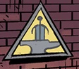

 **特别情报局（Special Intelligence Directorate）**是英国一个负责监测超自然活动的组织。

## 背景

关于 S.I.D. 人们所知甚少，只知道它至少在 20 世纪 50 年代仍在运作，总部设在废弃的伦敦塔地铁站内。它比其美国对口机构 [B.P.R.D.](/entry/Bureau_for_Paranormal_Research_and_Defense) 更为隐秘——后者公开行动，当时甚至不知道这个英国组织的存在。它与 [S.S.S.](/entry/Special_Sciences_Service) 之间似乎处于对立关系。有意思的是，1884 年一个名为[铸造厂](/entry/Foundry_%28organization%29)的组织使用着与 S.I.D. 相同的铁砧与剑标志，暗示两者之间存在关联。[1]

## 历史

1953 年，S.I.D. 联系了[特雷佛·布鲁顿霍姆](/entry/Trevor_Bruttenholm)教授，请他协助在香港取回一件神器。实际上，B.P.R.D. 是被派去收拾 S.I.D. 捅出的娄子——他们的一名特工叛变了。此前 Roland Childe 已向上级报告，[魂瓶](/entry/hunping)已在九龙城寨被毁。随后辛西娅·伊登-琼斯夫人转而处理另一件事：追踪两名前 S.S.S. 特工。[2]

## 特工

- [辛西娅·伊登-琼斯夫人](/entry/Lady_Cynthia_Eden-Jones)
- Margery Daw
- [Roland Childe](/entry/Roland_Childe)（已故）
- [Thomas Rhyme](/entry/Thomas_Rhyme)（前成员）

## 参考资料

<references />

[1] The Gates of Heaven

[2] *[Ghost Moon](/entry/Ghost_Moon)*
