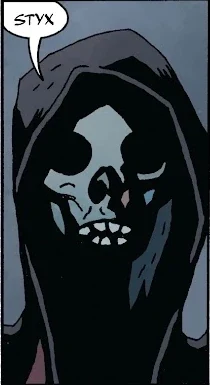

**斯堤克斯（Styx）**，又称**斯堤克斯海（Stygian Sea）**，是[地狱](/entry/Hell)中的一片广阔水域，环绕着火湖与[潘德莫尼姆](/entry/Pandemonium_(location))。斯堤克斯曾化出实体形体，担任地狱男爵在地狱中的向导之一，带他看了自己的母亲[莎拉·休斯](/entry/Sarah_Hughes)在生下他之前被关押和折磨的地方。

后来，[埃利戈斯](/entry/Eligos)被[爱德华·格雷](/entry/Edward_Grey)所杀——后者已化身为[阿刻戎](/entry/Acheron_(river))河，斯堤克斯便与[佛勒革同](/entry/Phlegethon)、[科库托斯](/entry/Cocytus)和[勒忒](/entry/Lethe)一起迎接这位新晋升华的兄弟，邀请他加入他们的行列。

