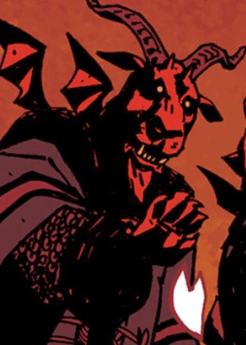

**西迪**（Sytry）曾是一名高阶[恶魔](/entry/Demon)。

## 历史

西迪、[约姆雅尔](/entry/Yomyael)（Yomyael）和[贝雷特](/entry/Beleth)（Beleth）是三位一体的恶魔，“自从人类对群星背后的黑暗萌生信仰以来”，他们便一直在战场上协助亚细亚人。

彼得大帝曾召唤西迪及另外两名恶魔，希望他们在大北方战争中帮助自己对抗瑞典人，但他们索要的回报是他未来的儿子们、他的心脏和他的灵魂。

## 传说

西迪是《所罗门之钥》（Ars Goetia）中的一位灵体，被描述为地狱的伟大亲王，麾下统辖六十个恶魔军团。据推测，他的原型是埃及神祇赛特。

## 登场

- (/entry/1946)
