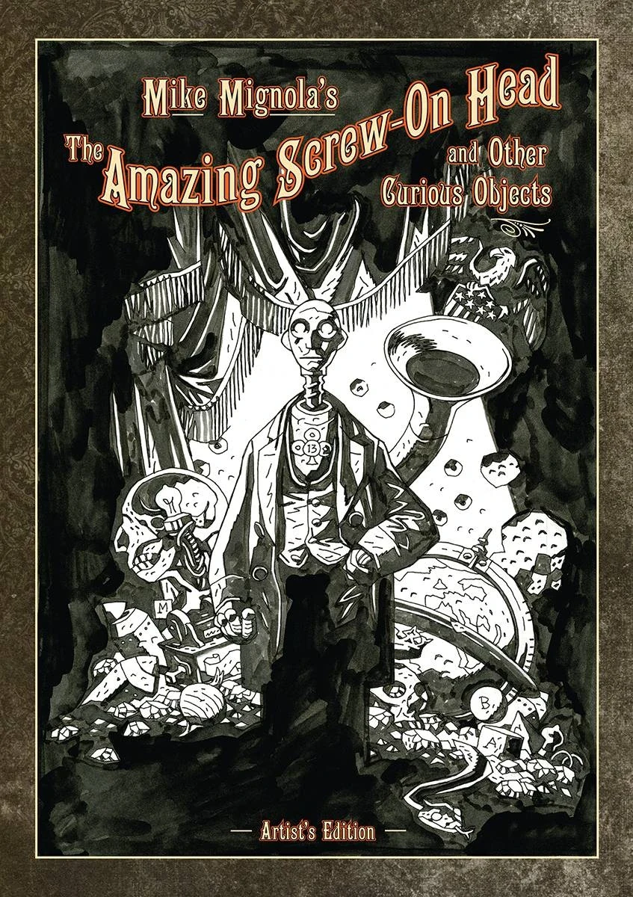
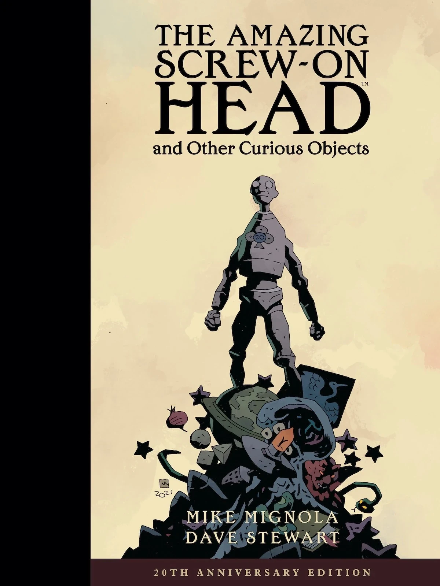

***《神奇的螺丝头与其他奇物》***(The Amazing Screw-On Head and Other Curious Objects)是黑马漫画出版的一部合集，收录了两篇此前出版、与地狱男爵宇宙有松散关联的故事——*[《神奇的螺丝头》](/entry/The_Amazing_Screw-On_Head)*与*[《魔法师与蛇》](/entry/The_Magician_and_the_Snake)*——以及若干扩写或全新的故事。

## 出版方简介

维多利亚时代的飞行器、一颗机械头颅、盗墓、鬼魂、女巫、木偶、外星人与巨型蔬菜——令人眼花缭乱的奇物游行尽在这本书中，其中包括荣获艾斯纳奖的故事《神奇的螺丝头》与《魔法师与蛇》，外加三篇从未出版过的故事，以及*[《地狱男爵》](/entry/Hellboy_(series))*创作者的其他新作。

## 收录故事

*《神奇的螺丝头与其他奇物》*分为两个部分。

### 第一部分：*《神奇的螺丝头》*

第一部分收录了*[《神奇的螺丝头》](/entry/The_Amazing_Screw-On_Head)*故事。故事之后是一个小栏目——*《神奇螺丝头秘密档案中新近出土的奇物》*，包含若干相关插画，全部由米格诺拉绘制，这些插画并未收录在最初的单行刊中。

### 第二部分：*《其他奇物》*

本部分按以下顺序呈现另外五个故事：

- *[《阿布·冈与豆茎》](/entry/Abu_Gung_and_the_Beanstalk)*（最初发表于 *《Scatterbrain》* 第 \#1 期，为本合集重新绘制）
- *[《魔法师与蛇》](/entry/The_Magician_and_the_Snake)*（最初发表于 *《Happy Endings》* ）
- *[《女巫与她的灵魂》](/entry/The_Witch_and_Her_Soul)*
- *[《火星囚徒》](/entry/The_Prisoner_of_Mars)*
- *[《在奇物礼拜堂中》](/entry/In_the_Chapel_of_Curious_Objects)*

## 附加内容

本合集还收录了全部六个故事的创作笔记，以及一本十一页的速写簿。

## 故事之间的联系及其与地狱男爵宇宙的关系

本合集中的所有故事都通过共同的角色与地点彼此关联。（更多细节请查阅每个故事各自的条目。）既然*[《神奇的螺丝头》](/entry/The_Amazing_Screw-On_Head)*与*[《魔法师与蛇》](/entry/The_Magician_and_the_Snake)*在地狱男爵宇宙中被设定为真实存在的小说与童话，那么可以想见，本合集中的所有故事都是以虚构作品的形式存在于地狱男爵宇宙之中。

## 艺术家版

2016 年，IDW 出版了《迈克·米格诺拉的神奇螺丝头与其他奇物：艺术家版》(*Mike Mignola's The Amazing Screw on Head and Other Curious Objects: Artist's Edition*)。这本超大开本的书以米格诺拉最初作画的尺寸呈现其墨线稿，未上色（其中一半故事连文字排印也没有）。

除了此前合集的全部内容外，*艺术家版*还收录了米格诺拉为[*《The Goon》*第 \#7 期](/entry/The_Goon_7)创作的内容（该期有[地狱男爵](/entry/Hellboy_(character))登场），以及一则由米格诺拉绘制、发表于 *《Dark Horse Presents》* 第 \#107 期的故事《Rusty Razorclam：海王星总统》。

## 二十周年纪念版

2022 年 8 月 10 日，黑马漫画出版了*《神奇的螺丝头与其他奇物二十周年纪念版》*。该纪念版没有沿用艺术家版中增加的内容，但含有四十页此前版本中没有的页面。新内容中有一半是[迈克·米格诺拉](/entry/Mike_Mignola)一则此前未曾出版的故事——*《屠魔者阿克萨斯》(Axorr, Slayer of Demons)*。另一半则是新增的彩色插画。

## 外部链接

- DarkHorse.com 上《神奇的螺丝头与其他奇物》产品页
