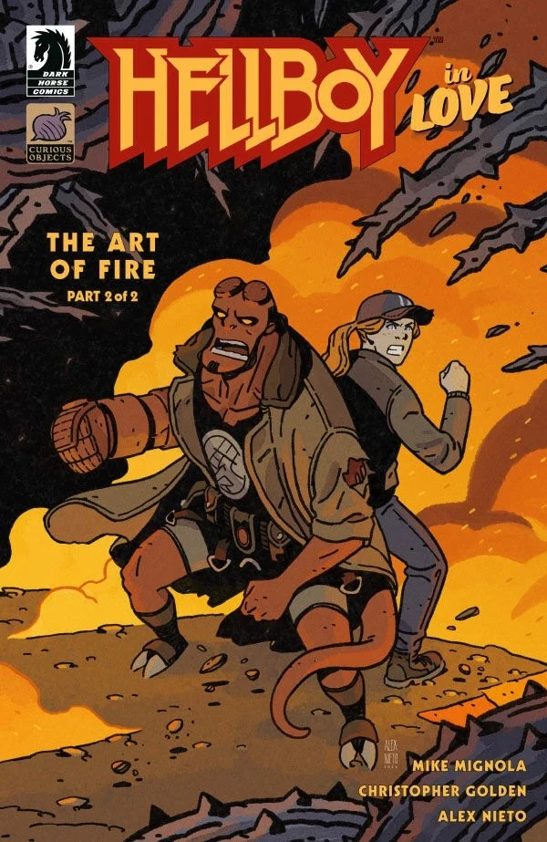

***《火之艺术》（The Art of Fire）***是 *[《恋爱中的地狱男爵》](/entry/Hellboy_in_Love)* 的一个两期故事弧，由 [Mike Mignola](/entry/Mike_Mignola) 和 [Christopher Golden](/entry/Christopher_Golden) 编剧。这是该系列的第四个故事弧，也是 Alex Nieto 在地狱男爵宇宙中的首次亮相。

## 剧情简介

### 第一部分

地狱男爵与考古学家阿纳斯塔西娅·布兰斯菲尔德（Anastasia Bransfield）长途跋涉前往冰岛，寻找一个看似不可能存在的秘术师网络的证据，但一处新发掘的遗址所蕴藏的答案，需要付出沉重而危险的代价。

### 第二部分

冰岛一个洞穴中的超自然实体给了地狱男爵和阿纳斯塔西娅他们所寻求的答案，但当二人试图带着新获得的知识离开时，它却另有打算。

## 画廊

全部封面由 Alex Nieto 绘制。

*《恋爱中的地狱男爵：火之艺术》* \#1

*《恋爱中的地狱男爵：火之艺术》* \#2

|Hellboy in Love: The Art of Fire #2
