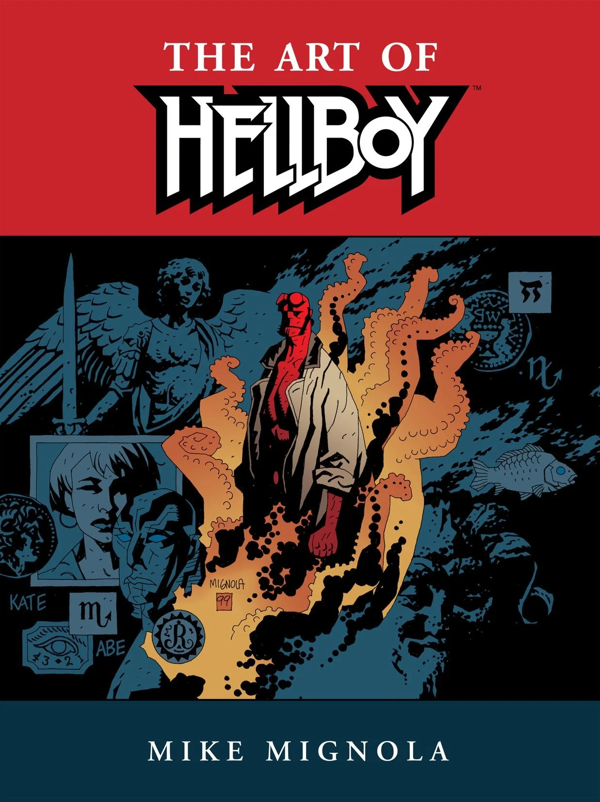

***《地狱男爵艺术集》（The Art of Hellboy）***是[黑马漫画](/entry/Dark_Horse_Comics)出版的一部画集。书中收录了[迈克·米格诺拉](/entry/Mike_Mignola)创作[地狱男爵](/entry/Hellboy_(series))头十年间的草稿初稿、成稿页面与批注。

## 出版商简介

*这部厚达两百页的精美画集回顾了迈克·米格诺拉在其屡获殊荣的漫画系列上十年间的艺术演变。《地狱男爵艺术集》收录了此前未曾发表的画作、未被采用和未完成的封面，并取材于十年间的速写本，让读者得以终极窥探米格诺拉的设计、叙事与上色工作；珍稀且从未公开过的画作揭示了创作这部漫画界最富盛誉作品之一所倾注的心血。*

## 出版历史

*《地狱男爵艺术集》*最初以大开本精装书的形式出版，后来成为[*《地狱男爵》图书馆版*](/entry/Hellboy_Library_Editions)的基础。一年后，它又以较小开本的平装形式重印。

## 知名收录内容

*《地狱男爵艺术集》*收录了《嗨，我叫地狱男爵》（Hi, My Name's Hellboy）以及 *[《沃尔科拉克》](/entry/The_V%C3%A2rcolac)*（The Vârcolac）原版的唯一重印版本。

## 封面画廊

精装版

平装版

|Paperback
## 外部链接

- DarkHorse.com 上的《地狱男爵艺术集》（精装版）产品页
- DarkHorse.com 上的《地狱男爵艺术集》（平装版）产品页
