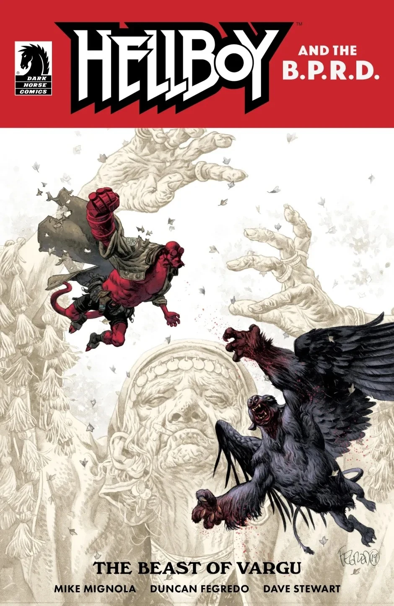

***《瓦尔古的野兽》***是《地狱男爵与超自然调查防御署》(*Hellboy and the B.P.R.D.*) 的一期单刊，故事设定在 1962 年，由 [Mike Mignola](/entry/Mike_Mignola) 编剧、[Duncan Fegredo](/entry/Duncan_Fegredo) 作画。这是《地狱男爵与超自然调查防御署》系列首次在时间线上向前跳跃，而不是沿用此前各刊逐年推进的形式。本期还收录了短篇故事*[《罗姆人的隐秘神祇》](/entry/The_Secret_God_of_the_Roma)*。

## 剧情简介

作为《地狱男爵与超自然调查防御署》全新时代的首期，Mignola 与 Fegredo 把地狱男爵派往罗马尼亚，讲述发生在一座小村庄里的两个故事：村里背负着延续数百年的诅咒，还有一头吃人的怪物。两个故事最终汇聚于一场诡异的木偶戏，以及一位半神注定失败的晚宴。

## 画廊

[Duncan Fegredo](/entry/Duncan_Fegredo) 封面

[Mike Mignola](/entry/Mike_Mignola) 变体封面

地狱男爵与超自然调查防御署出版顺序

&#10;
前作
1956
瓦尔古的野兽

后作
罗姆人的隐秘神祇

|Duncan Fegredo cover
